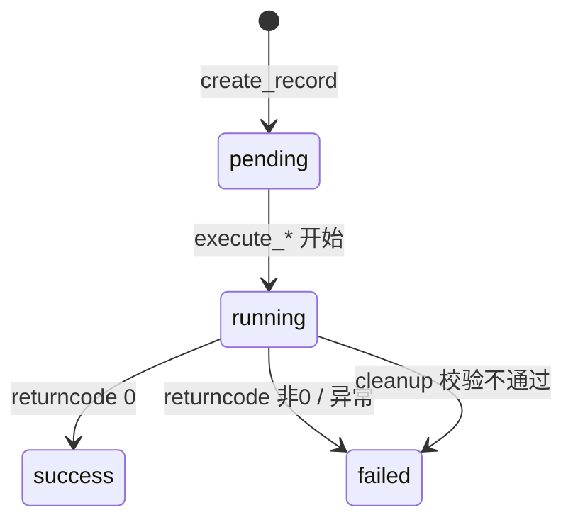
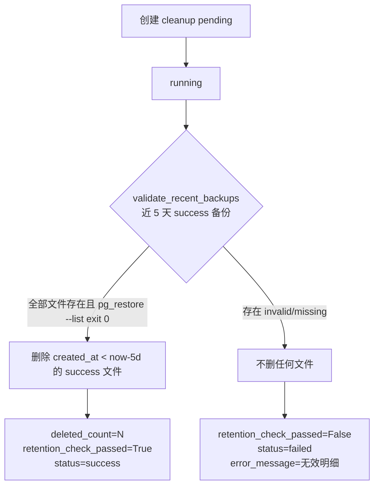

# 数据备份功能 — 技术设计

## 1. 分层与文件清单

| 层 | 文件 | 动作 |
|---|---|---|
| 配置 | `backend/app/config.py` | `Settings` 增 3 字段（Redis 配置后） |
| 配置 | `.env.example` | 增 `BACKUP_DIR` / `BACKUP_RETENTION_DAYS` / `BACKUP_CLEANUP_INTERVAL_DAYS` |
| 容器 | `deploy/docker/Containerfile` | apt-get install 块加 `postgresql-client` |
| 模型 | `backend/app/models/backup.py` | 新建 `BackupScheduleConfig` + `BackupRecord` |
| 模型 | `backend/app/models/__init__.py` | isort-off 块 + `__all__` 注册 |
| 迁移 | `backend/alembic/versions/c9d0e1f2a3b4_add_backup_feature.py` | 建两表 + 默认配置行 + 权限种子 + 关联超管 |
| 种子 | `backend/scripts/seed.py` | `ALL_PERMISSIONS` 增一条 |
| 测试数据 | `backend/tests/_test_data.py` | `PERMISSION_ROWS` 增一条 |
| 服务 | `backend/app/services/backup_service.py` | 新建 `BackupService` |
| 任务 | `backend/app/tasks/backup.py` | 新建执行函数 + 动态注册函数 |
| 调度 | `backend/app/tasks/scheduler.py` | 注册备份/清理闭包 + 清理 IntervalTrigger |
| 路由 | `backend/app/routes/backup.py` | 新建 7 个端点 |
| 入口 | `backend/app/main.py` | 蓝图注册 |
| 前端菜单 | `frontend/src/components/layout/AppSidebar.vue` | 「数据清空」后插「数据备份」 |
| 前端路由 | `frontend/src/router/index.ts` | system 组增 `backup` 子路由 |
| 前端冗余菜单 | `frontend/src/composables/useAppLayout.ts` | `navSections` + `isSubmenuActive` + watch 补一行 |
| 前端页面 | `frontend/src/views/system/BackupManagement.vue` | 新建页面 |
| 测试 | `backend/tests/unit/test_backup_service.py`、`test_backup_routes.py` | 新建 |

## 2. 数据模型

### BackupScheduleConfig（`backup_schedule_configs`）

复刻 `SyncScheduleConfig`，去掉 `sync_mode`：

| 字段 | 类型 | 约束 | 说明 |
|---|---|---|---|
| id | Integer | PK | |
| task_name | String(50) | NOT NULL UNIQUE | 单行 `daily_backup` |
| enabled | Boolean | NOT NULL default false | 是否启用每日备份 |
| backup_time | String(5) | NOT NULL default `02:00` | HH:MM |
| updated_by | Integer FK users.id | NULL | 更新人 |
| created_at / updated_at | DateTime | NOT NULL server_default now() | TimestampMixin |

### BackupRecord（`backup_records`）

Integer 自增主键（对比 `SyncTask` 的 UUID：备份记录无外部幂等语义，Integer 便于 URL 传参 `/records/<int:rid>`）：

| 字段 | 类型 | 说明 |
|---|---|---|
| id | Integer PK | |
| task_type | String(20) NOT NULL | `daily_backup`/`manual_backup`/`cleanup`/`restore` |
| status | String(20) NOT NULL default pending | `pending`/`running`/`success`/`failed` |
| file_path | String(500) NULL | 相对 backup_dir 的路径；cleanup 为空；restore 为源备份路径 |
| file_size_bytes | BigInteger NULL | |
| backup_date | Date NULL | 备份业务日期（cleanup 空；restore 取源） |
| retention_check_passed | Boolean NULL | 仅 cleanup |
| deleted_count | Integer NOT NULL default 0 | 仅 cleanup |
| duration_seconds | Integer NULL | |
| error_message | Text NULL | |
| operator_id | Integer FK users.id NULL | 定时为 NULL |
| started_at / completed_at | DateTime(tz) NULL | |

索引：`idx_backup_records_type_date` on `(task_type, backup_date)`、`idx_backup_records_status` on `(status)`。

**不继承 SoftDeleteMixin**（与 sync 系列一致，留痕不软删）。

## 3. 状态机



## 4. 核心流程

### 4.1 备份（daily/manual 共用 `execute_backup`）

`create_record`（pending, started_at=cst_now）→ `status=running` commit → `_run_pg_dump(dest)` → 成功：`file_path`（相对路径）/`file_size_bytes`/`duration_seconds`/`status=success`/`completed_at`；失败：`status=failed`/`error_message`（stderr 截断 2000 字）。

文件名 `backup_YYYYMMDD_HHMMSS.dump`（CST 时刻）。DB 落**相对路径**，`_abs_path()` 解析为 `backup_dir / rel` 并校验 `is_relative_to(backup_root)`。

### 4.2 清理（`execute_cleanup`）



`validate_recent_backups` 返回 `{"passed","total","valid","invalid_records","missing"}`。

### 4.3 恢复（`execute_restore`）

校验源记录（`task_type in (daily_backup, manual_backup)` + `status=success` + `file_path` 非空 + 文件存在 + 路径在 backup_dir 内）→ 建 restore 记录（`file_path`/`backup_date` 取自源）→ `_run_pg_restore`（`pg_restore --clean --if-exists -d <db_url> <file>`）→ 终态。仅以 returncode 判定（`--clean` 的 DROP notice 在 stderr 但 returncode 0）。

### 4.4 路径安全

所有磁盘操作前 `_abs_path(rel) -> Path`：
```python
root = Path(settings.backup_dir).resolve()
target = (root / rel).resolve()
if not target.is_relative_to(root): raise ValueError("备份文件路径非法")
```

## 5. 调度

- `register_backup_daily(session_factory, enabled, backup_time)`：幂等 remove→add；`CronTrigger(hour, minute, timezone=CST)`；闭包内二次查 `BackupScheduleConfig.enabled`（页面刚关闭则跳过）。
- `start_scheduler` 内：读配置决定是否注册（配置表未迁移时 except 降级不注册，与 sync 一致）；清理 job 固定注册 `IntervalTrigger(days=settings.backup_cleanup_interval_days)` + `next_run_time=cst_now()+timedelta(days=N)`（避免启动即清理）。
- 恢复不注册 scheduler（纯手动）。

## 6. 路由契约

前缀 `/api/v1/system/backup`，全部 `@auth_required`：

| 方法 | 路径 | 权限 | 行为 |
|---|---|---|---|
| GET | `/schedule` | `system:view` | 配置 + `next_run_time` |
| PUT | `/schedule` | `system:database_backup` | 校验时间格式/enabled 类型 → 更新 commit → `register_backup_daily` 立即生效 |
| GET | `/records` | `system:view` | 分页 `?page&page_size&task_type` |
| GET | `/records/<rid>` | `system:view` | 单条 |
| POST | `/perform` | `system:database_backup` | 建 manual_backup pending → `request.app.add_task` 异步执行 → 201 |
| POST | `/records/<rid>/restore` | `system:database_backup` | 体 `{confirm_date}`；不匹配源 `backup_date` → 400 不建记录；否则建 restore pending → 异步执行 → 201 |
| GET | `/records/<rid>/download` | `system:database_backup` | `response.file()` 流式 |

后台执行用 `request.app.add_task(coro)`（复刻 `sync_tasks.py:155-166`，Sanic 生命周期管理，避免裸 `asyncio.create_task` 被 GC）。

## 7. 时区口径

- 调度触发：`CronTrigger(timezone=CST)`
- 记录时间：`cst_now()`（aware）写 `DateTime(timezone=True)`
- `backup_date`：`cst_today()`（date）
- 清理窗口：`cst_now() - timedelta(days=N)`；`created_at` 是 **naive**（`TimestampMixin` 用 `DateTime` 无 tz，server_default now() 由 DB 时区决定）→ 比较时用 `cst_now().replace(tzinfo=None)` 剥离 tzinfo（复刻 `scheduler.py:99` 的 asyncpg naive 约束做法）
- 文件名时间戳：`cst_now().strftime("%Y%m%d_%H%M%S")`

## 8. 兼容与回滚

- **迁移回滚**：downgrade 反向删 role_permissions → permissions → drop 两表
- **配置缺失**：`_get_or_create_config` 惰性建行；scheduler 读配置异常时降级不注册（不影响其他 job）
- **镜像**：`postgresql-client` 加装不影响现有层（与 build-essential/libpq-dev 同块）；若部署侧不允许改镜像，备份/恢复执行不可行（计划的 fallback 需用户另行确认，本方案按加装执行）
- **既有路径问题（不修，超范围）**：`deploy/docker-compose.yml` 的 app/migrate/seed/cleanup 四个服务 `dockerfile: ./docker/Containerfile` + `context: ../backend` 解析为 `backend/docker/Containerfile`（不存在）；CI 部署（`deploy.yml`）用 `./deploy/docker/Containerfile` 正常。镜像构建验证按 CI 口径执行：`docker build -f deploy/docker/Containerfile backend/`

## 9. 前端页面结构

```
PageHeader
├─ a-alert (warning)：恢复将覆盖整库，建议低峰期执行，恢复后需重启服务
├─ a-card「定时备份配置」：a-switch + a-input(HH:MM) + 保存按钮 + 下次执行时间
├─ a-card「备份操作」：立即备份按钮（Modal.confirm → POST perform → 轮询）
└─ a-card「任务记录」：a-table（分页 + task_type 筛选）
    └─ 操作列：仅 backup 类 success 行显示 下载 / 恢复
        └─ 恢复 → Modal.confirm 内嵌 a-input 输入备份日期 → POST restore
```

轮询：`setInterval` 3s 拉 `GET /records`，无 running/pending 记录时停止（`onUnmounted` 清理）。
