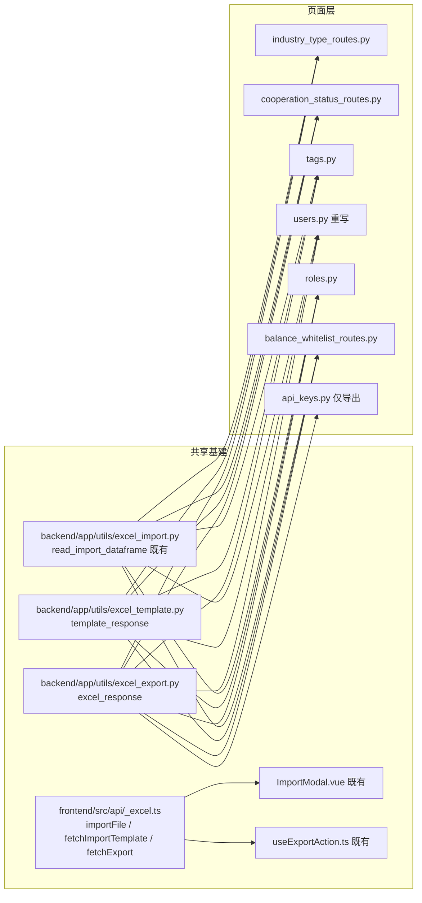

# 技术设计：批量为 7 个管理页面新增导入/导出

## 1. 总体架构



## 2. 关键契约（全部新端点统一）

### 2.1 后端导入端点骨架（照抄 customers.py:1000-1333）

```python
@bp.post("/import")
@auth_required
@require_permission("<module>:import")
async def import_xxx(request: Request):
    files = request.files
    if "file" not in files:
        return json({"code": 40001, "message": "请上传 Excel 文件"}, status=400)
    excel_file = files["file"][0]
    if not excel_file.name.endswith(".xlsx"):
        return json({"code": 40002, "message": "请上传 .xlsx 格式的文件"}, status=400)
    try:
        df = await asyncio.to_thread(read_import_dataframe, excel_file.body, "<first_column>")
        required = [...]
        missing = [c for c in required if c not in df.columns]
        if missing:
            return json({"code": 40003, "message": f"Excel 缺少必填列：{', '.join(missing)}"}, status=400)
        records = df.to_dict(orient="records")
        for idx, rec in zip(df.index, records):
            rec["_row_num"] = int(idx) + 2          # 真实 Excel 行号
        dry_run = request.args.get("dry_run", "").lower() in ("1", "true", "yes", "on")
        # 行级预检（只读，事务外）→ valid_rows / errors
        # dry_run: return {dry_run:True, success_count, error_count, errors[:50]}
        # 正式: async with db_session.begin(): db.add(...) → return {success_count, error_count, errors[:10]}
    except Exception:
        logger.exception("...导入失败")
        return json({"code": 50001, "message": "导入失败，请稍后重试"}, status=500)
```

- NaN 判空：`isinstance(v, float) and math.isnan(v)`（禁止 `bool(NaN)`）。
- 数值列解析：float→`is_integer()` 守卫后 `int(x)`；int 透传；str→strip 后 `int()`。**禁止 `int(str(x))`**。
- 错误格式：`f"第{row['_row_num']}行：..."`（PLAN 指定风格，与既有 `行N:` 风格并存，不回溯统一）。

### 2.2 excel_response（新建，`utils/excel_export.py`）

```python
def excel_response(records: list[dict], sheet_name: str, filename_prefix: str, total: int | None = None):
    """records → DataFrame → xlsx → raw。空数据返回 40002；超过 50000 截断并置 X-Truncated。"""
```

- `truncated = (total if total is not None else len(records)) > 50000`——total 由 service 返回的真实总数传入（客户页 `_export_limit` 死变量的修正：PLAN 版本只比 records 长度，截断提示不准）。
- 空数据 → `json({"code": 40002, "message": "无数据可导出"}, status=400)`（遵循既有 balances 导出自洽）。
- 返回头：`Content-Disposition: attachment; filename="{prefix}_{YYYYmmdd_HHMMSS}.xlsx"`，截断时加 `X-Truncated: true`。

### 2.3 excel_template（新建，`utils/excel_template.py`）

`template_response(columns: list[tuple[str,str,str]], filename, sheet_name="导入模板")`：
3 行结构（英文列名 / 中文说明（必填：/可选： 前缀）/ 示例），列宽 25。中文说明行是 `_is_template_note_row` 的判定依据，前缀必须保留。

### 2.4 事务策略（对 PLAN 的修正）

调研发现 roles/tags/industry/coop 的 service `create_*` 内部自带 commit，外层再包 `db_session.begin()` 会嵌套事务报错。**决策：导入落库一律在路由层 `async with db_session.begin():` 内直接 `db.add(Model(...))`，不调用 service.create_*；行级预检（查重/字典解析）在事务外用只读查询完成。** 例外：
- users：`UserService.create_user` flush 不 commit、`assign_roles` 清空重设（实现时确认其内部无 commit；若有则改为路由层直写 user_roles 关联）。
- tags 落库后（事务外）必须 `await cache_service.invalidate_tag_cache()`。
- 软删占位：行业类型/合作状态/余额白名单的唯一索引对软删记录仍生效，**查重必须含软删记录**（select 不加 `deleted_at IS NULL`），否则 INSERT 撞唯一约束 500。

### 2.5 权限码（13 条）

| code | name | module |
|---|---|---|
| tags:import / tags:export | 导入/导出标签 | tags |
| users:import / users:export | 导入/导出用户 | users |
| roles:import / roles:export | 导入/导出角色 | roles |
| industry_types:import / industry_types:export | 导入/导出行业类型 | industry_types |
| cooperation_statuses:import / cooperation_statuses:export | 导入/导出合作状态 | cooperation_statuses |
| balance_whitelist:import / balance_whitelist:export | 导入/导出余额白名单 | balance_whitelist |
| api_keys:export | 导出API-Key | api_keys |

- module 用各模块名（PLAN 决策）：权限配置页独立成组；`permissionGroups.ts` 的 `MODULE_NAME_MAP` 补 5 个中文映射、`MODULE_ORDER` 追加，否则分组标题显示原始 key。
- `module:manage` 通配符不含 import/export（`_check_permission` 白名单仅 read/write/delete/create/update），13 码必须显式授予。
- 四处同步：`seed.py ALL_PERMISSIONS`（4 元组）、`tests/_test_data.py PERMISSION_ROWS`（3 元组）、`tests/integration/conftest.py`（注册列表 + FULL_PERMISSIONS）、补丁脚本。
- 补丁脚本：仿 `fix_add_view_all_permission.py`，`INSERT ... ON CONFLICT (code) DO NOTHING` + role_permissions 幂等关联；超管全授；运营经理授 7 个 export（与既有 `billing:*_export` 惯例对齐）；销售经理授 tags/users/roles/balance_whitelist export（PLAN 指定）。import 一律不预授。

### 2.6 前端

- `_excel.ts`：`importFile(url, file)` / `fetchImportTemplate(url)` / `fetchExport(url, params?)`；`billing.ts` import + re-export，删除本地定义。
- 页面按钮模式（照抄 PackagePlans.vue:13-15）：
  ```html
  <a-button v-if="can('xxx:export')" :loading="exporting" @click="handleExport">导出</a-button>
  <a-button v-if="can('xxx:import')" @click="importVisible = true">导入</a-button>
  ```
- 导出截断提示（照抄 Balance.vue:337-353）：`onSuccess` 读 `res.headers['x-truncated']`。
- 各页 api 函数命名沿用各文件现有风格（system 字典页用 `List` 后缀；users/roles/tags 无后缀）。

## 3. 各页面数据契约

| 页面 | 导出列 | 导入列（必填*） | 重复检查 | 备注 |
|---|---|---|---|---|
| 行业类型 | name, sort_order | name*, sort_order(默认0) | name 全量（含软删） | 导出全量无筛选 |
| 合作状态 | name, value, sort_order | name*, value*, sort_order(默认0) | name / value 全量 | value 不可重复 |
| 标签 | name, type(中文名), category | name*, type*(customer/profile), category | (name,type) 唯一 | 导出按 activeTab 传 type；落库后 invalidate_tag_cache |
| 用户 | id, username, email, real_name, is_active, roles(逗号拼接), phone, created_at | username*, email, real_name, role(逗号分隔), initial_password* | username（get_user_by_username） | legacy 重写；role 按 name 解析 |
| 角色 | id, name, description, is_system, permissions(code 逗号拼接) | name*, description, permissions(code 逗号分隔) | name | 全量导出无 keyword（get_all_roles 无 keyword 参数） |
| 余额白名单 | id, company_id, customer_name, erp_system, static_balance, remark, created_at | company_id*, static_balance(默认1000), remark | customer_id 全量（含软删） | company_id→customer.id 解析（deleted_at IS NULL）；与 ERP batch-import 并存 |
| API-Key | id, name, key_prefix(脱敏), status, description, created_by, expires_at, last_used_at, created_at | — | — | 仅导出，复用 `_format_api_key` |

导出统一走 `excel_response`；数据源：industry/coop `get_all()`、tags `get_all_tags(1,50000,type)`、users `get_all_users(1,50000,keyword)`、roles `get_all_roles(1,50000)`、balance_whitelist `get_all(1,50000,keyword)`（已序列化 dict）、api_keys `get_all(1,50000)`。

## 4. 与 PLAN 的差异处置（调研结论）

| # | PLAN 原文 | 调研事实 | 处置 |
|---|---|---|---|
| 1 | 补丁脚本 + seed + _test_data 三处同步 | 还有 `tests/integration/conftest.py` 权限注册 + FULL_PERMISSIONS | 补第四处 |
| 2 | `permissionGroups.ts` 无需改动 | 新 module 无中文映射，分组标题显示原始 key | 补 MODULE_NAME_MAP/MODULE_ORDER |
| 3 | service.create_* + `db_session.begin()` | service.create_* 内部自 commit，嵌套事务 | 路由层直写 db.add |
| 4 | 查重 get_by_name（仅未删） | 唯一索引对软删生效，漏查 → 500 | 查重含软删 |
| 5 | `excel_response(records, ...)` 截断判断 | 客户页 `_export_limit` 是死变量；真正先例 balances.py 用 total | 构造器加 `total` 参数 |
| 6 | 导出端点未提空数据 | 既有约定空数据 40002 | excel_response 内置 |
| 7 | 未提缓存 | tags 列表有缓存，写后必须 invalidate | 补 invalidate_tag_cache |
| 8 | 未提 to_thread | customers/pricing 均 `await asyncio.to_thread(read_import_dataframe, ...)` | 照抄 |
| 9 | users legacy 逐行审计 | 客户页新模式只写汇总审计 | 汇总审计（build_batch_audit_summary + create_audit_entry） |

## 5. 风险与回滚

- 单 PR 交付，回滚 = revert 整个 commit 序列；schema 无变更，无迁移。
- 补丁脚本幂等，可重复执行；存量库权限由补丁脚本补齐。
- users 端点重写是唯一破坏性变更（响应结构变化），前端 `api/users.ts` 的 `importUsers` 同 PR 更新，无外部消费方。
