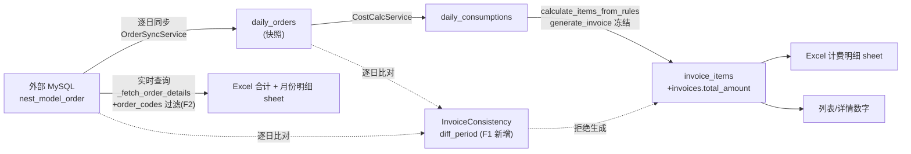
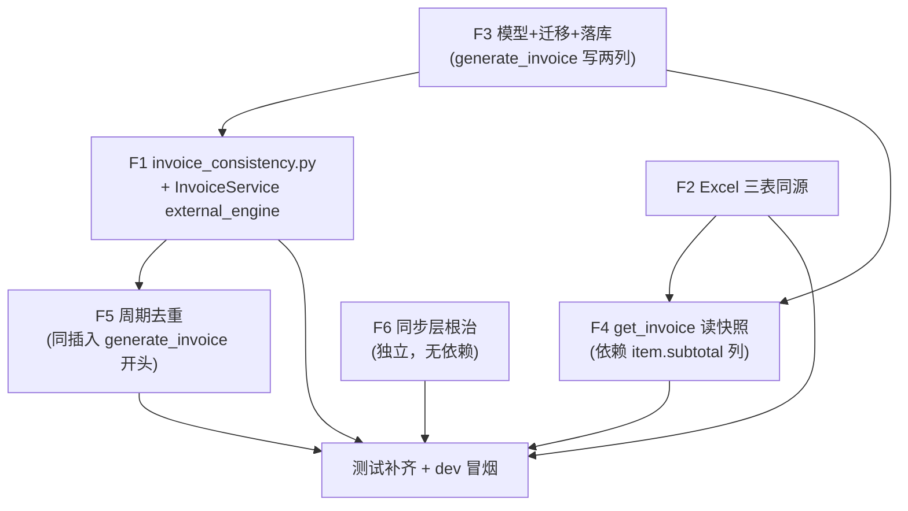

# 结算单明细数据一致性修复 — 技术设计

> 任务：`.trellis/tasks/11-05-invoice-consistency-fix` · 基于 PLAN 定稿 + 2026-11-05 五路代码锚点调研修正

## 0. 对 PLAN 的修正（调研实证，实现按本设计执行）

| # | PLAN 表述 | 实际情况（调研） | 修正 |
|---|---|---|---|
| M1 | `BillingService` | 仓库无此类；实际为 **`InvoiceService`**（`backend/app/services/billing.py:1046`），`generate_invoice` :1382、`generate_invoices_batch` :2257、`calculate_items_from_rules` :1061 | 全文按 `InvoiceService` 实施 |
| M2 | `calculate_items_from_rules` 四个分支补 subtotal | **六个分支**（package×3 / fixed×2 / tiered×1）且**六分支均已带 `subtotal` 与 `order_count` 键** | F3 **不改** `calculate_items_from_rules`；只改 `generate_invoice` 的 `InvoiceItem` 落库循环（:1440-1446） |
| M3 | F4 字段列了 8 个 | `get_invoice` 实际格式化 **20 字段**；其中包年计算字段 `usage_cost`/`over_limit_*`/`period_days` 被前端 `invoiceFormatters.formatRuleDetail`（:77-101）实际消费，**不能置空丢失** | 见决策 D2：包年字段经 `daily_consumptions` 还原 |
| M4 | 前端已有 `order_count ?? quantity` 兜底 | 兜底在 `InvoiceDetailDrawer.vue:389`（totalUsage）；`invoiceFormatters.ts` 用 `order_count != null && != quantity`（:34）与 `?? 0`（:54） | F4 响应保持 20 字段结构 → 前端零改动；不为改前端 |
| M5 | 迁移接「当前 head」 | head = **`e2f3a4b5c6d7`**（`add_remark_to_vr_settlements.py`，41 个迁移线性链尾推导） | 实现时以 `cd backend && python -m alembic heads` 实测为准，再设 `down_revision` |
| M6 | `_fetch_order_details` 容错语义 | 异常→`None`；引擎未配置/`group_type` 缺失→`[]`（空列表） | F1 自有查询：引擎未配置或异常**一律返回 None**（放行），不复用 `[]` 语义 |
| M7 | 「unit_price 参数保留但不再参与数量口径」 | `unit_price` 形参在 `_build_and_save_excel` 体内从未被引用（死参数），小计已逐 item 取 `invoice_items[i]["unit_price"]` | F2 保持签名不动；仅改小计取值来源为 `item["subtotal"]` |

## 1. 总体数据流与断点



改动后：G 与 D 同源（F2 order_codes 过滤）；F 只读 D（F4）；D 生成前被 H 拦截（F1）；B 的生成入口修复当天跳过与跨日残留（F6）；D 前加周期去重（F5）；D 落库 subtotal/order_count（F3）。

## 2. F1 一致性校验（新文件 `backend/app/services/invoice_consistency.py`）

### 2.1 类型与入口

```python
@dataclass(frozen=True)
class DayDiff:
    day: str        # CST 日期 'YYYY-MM-DD'
    external: int   # 外部可结算订单数
    local: int      # daily_orders 行数

class InvoiceConsistencyError(ValueError):
    """快照与外部实时数据不一致（拒绝生成结算单）"""
    def __init__(self, customer_name: str, diffs: list[DayDiff]): ...

async def diff_period(
    customer_id: int,
    company_id: int,
    period_start: datetime,
    period_end: datetime,
    external_engine,          # Optional[AsyncEngine]
    db_session,               # AsyncSession（本地 PG）
) -> list[DayDiff] | None     # None = 无法校验（外部不可达/未配置），调用方放行
```

- 继承 `ValueError`：符合项目「业务错误用 ValueError」约定（error-handling.md 禁自定义异常类的精神通过「可区分的 ValueError 子类」满足——路由层需把它与普通 ValueError 分开转 40001 文案，其余 ValueError 维持现状）。路由层先 `except InvoiceConsistencyError` 再 `except ValueError`。
- 文案（`InvoiceConsistencyError.__str__` 或 message 属性）：

```
客户「住在好房」(company_id=1543) 2026-10 账期数据不一致，已拒绝生成结算单：
  2026-10-31 外部可结算订单 17 笔，本地已同步 7 笔（缺 10 笔）
请对上述日期执行「强制覆盖」模式同步后重新生成。
```

批量场景：每个客户独立抛/收集，`skipped[].reason` 用同一文案。

### 2.2 外部侧（一条 SQL，CST 日分桶）

```sql
SELECT DATE(D.upload_date + INTERVAL 8 HOUR) AS d, COUNT(*) AS c
FROM nest_model_order D
WHERE D.group_type = :group_type
  AND D.upload_date >= :start_dt AND D.upload_date < :end_dt
  AND ((D.order_status >= 3 AND D.order_status <= 12) OR D.order_status = 15)
GROUP BY DATE(D.upload_date + INTERVAL 8 HOUR)
```

- `start_dt = period_start`，`end_dt = period_end + timedelta(seconds=1)`——与 `_fetch_order_details`（invoice_excel.py:233-271）**完全同窗**。
- `+ INTERVAL 8 HOUR`：外部 `upload_date` 是 naive UTC 墙钟（pymysql 渲染），折算成 CST 日历日，与 `local_date_to_utc_start()` 语义一致（PLAN 1.4 已实证：272 笔 16:00 边界样本日/月边界严格对齐）。

### 2.3 本地侧

```python
select(DailyOrder.sync_date).where(
    DailyOrder.customer_id == customer_id,
    DailyOrder.sync_date >= period_start,
    DailyOrder.sync_date < period_end + timedelta(seconds=1),
    DailyOrder.deleted_at.is_(None),
)
```

- Python 侧 `utc_to_cst_date_str()`（utils/timezone.py:127）分桶计数——避免 PG 会话时区差异（database-guidelines.md 契约）。
- 返回两个方向的差异日：外部有本地无（缺同步）、本地有外部无（残留/过期）。

### 2.4 接入点与 external_engine 传递

**决策 D1：`InvoiceService.__init__` 增加第三参 `external_engine: Optional[AsyncEngine] = None`。**

- `generate`（invoices.py:771）与 `generate-batch`（:636）两个路由实例化时传 `getattr(request.app.ctx, "external_mysql_engine", None)`（main.py:345 挂载，invoices.py:94 已有先例）。
- 其余 20+ 处实例化不传（None）——它们不走生成路径，无影响。
- `tasks/invoice_generator.py:57` 的 `InvoiceService(session)` 单参调用本就与现签名不匹配（`# pyright: ignore[reportCallIssue]`，疑似死路径），external_engine=None → F1 放行 + warning，行为兼容。
- `generate_invoice()` 内顺序：`_check_invoice_period_overlap`（F5，本地 PG 快）→ F1 校验（外部 MySQL 慢）→ 单号生成 → 落库。快速失败优先。
- `generate_invoices_batch()` 循环内：`calculate_items_from_rules` 之后、`generate_invoice` 之前校验；不一致 → `skipped.append({"customer_id", "name", "reason"})` + continue（复用 :2318 结构）。**不能放进 `calculate_items_from_rules`**——它外层的 `except Exception`（:2311-2314）会把异常吞成 `calc_error`（ScoutRoutes 风险点确认）。
- `regenerate-detail`（:2644）不跑 F1（单已存在）；F2 备注列兜底暴露差异。

## 3. F2 Excel 三表同源（`invoice_excel.py` + `invoice_detail_generator.py`）

1. `_fetch_order_details()` 增 `order_codes: set[str] | None = None`；非 None 时 `[row for row in rows if row["order_code"] in order_codes]`（Python 侧过滤，不改 SQL，避免大 IN 列表）。None 时行为不变（兼容其它调用方）。
2. `invoice_detail_generator` 阶段 1（session 关闭前）新增查询：

```python
code_rows = await session.execute(
    select(DailyOrder.order_code).where(
        DailyOrder.customer_id == customer_id,
        DailyOrder.sync_date >= period_start,
        DailyOrder.sync_date < period_end + timedelta(seconds=1),
        DailyOrder.deleted_at.is_(None),
    )
)
order_codes = {r[0] for r in code_rows}
```

   经既有参数链传入 `generate_detail_file(..., order_codes=order_codes)` → `_build_and_save_excel` → `_fetch_order_details`。集合为空 → 月份明细空表（与「合计 0 套」自洽）。
3. `_build_and_save_excel()`：
   - `model_count = sum(Decimal(str(item.get("order_count") or 0)) for item in invoice_items)`；「模型总数量」与「计费模型数量」同取该值（invoice_excel.py:539-540）。
   - `len(order_details) != int(model_count)` 时「备注」列（J 列，:558）写：`外部实时订单 {n} 笔，本单计费 {m} 笔，差异 {d} 笔（请核对同步完整性）`。
   - 「计费明细」小计（E 列，:675）：`subtotal = float(item.get("subtotal") or Decimal(str(item.get("quantity", 0))) * Decimal(str(item.get("unit_price", 0))))`——历史/显式 items 无 subtotal 时回退旧口径。
4. `unit_price` 形参保留不动（M7：本就是死参数）。

## 4. F3 `invoice_items` 加两列（模型 + 迁移 + 落库）

- 模型 `InvoiceItem`（models/billing.py:238-256，252 行注释处）新增：

```python
subtotal: Mapped[Decimal | None] = mapped_column(DECIMAL(12, 2), nullable=True,
    comment="真实小计（多层递增/阶梯/包年下 ≠ quantity×unit_price）")
order_count: Mapped[int | None] = mapped_column(Integer, nullable=True,
    comment="计费订单数（多层递增时 quantity 为层数，需此列还原单数）")
```

  注解可空与 nullable 一致（database-guidelines.md 2.0 声明契约）。类型与现有 `quantity: DECIMAL(10,2)` 对齐用 `DECIMAL(12,2)`（金额上限余量，与 PLAN 一致）。
- 迁移 `<hex>_add_invoice_item_subtotal_order_count.py`：`down_revision = "e2f3a4b5c6d7"`（以 `alembic heads` 实测为准）；两列 `nullable=True` 无 server_default；`downgrade()` 对称 drop。
- `generate_invoice` 落库循环（:1440-1446）补：

```python
subtotal=Decimal(str(item["subtotal"])) if item.get("subtotal") is not None else None,
order_count=int(item["order_count"]) if item.get("order_count") is not None else None,
```

  显式 items 路径（调用方自造 dict）无这两键 → None，展示层 COALESCE 兜底。
- **守卫**：`tests/integration/test_migrations.py::TestModelMigrationParity`（空库 upgrade 后 compare_metadata）自动捕获漏迁移。
- **Schema Drift 硬规则**（backend/index.md Quality Check 第 8 条）：迁移写后必须 `python -m alembic upgrade head` + `check_schema_drift.py` 应用到运行库。

## 5. F4 详情读冻结快照（`routes/billing/invoices.py` get_invoice）

### 5.1 删除与替换

- 删除 :274-288 实时重算块（含 `except TierFormatError` 分支；TierFormatError  import 若他处不再使用一并清理）。
- `get_invoice_by_id`（services/billing.py:1551-1564）selectinload 链增加 `.selectinload(InvoiceItem.pricing_rule)`（`Invoice.items` 已加载；pricing_rule 未加载，async 下不显式加载访问即 MissingGreenlet）。

### 5.2 响应组装（决策 D2：包年字段还原）

`formatted_items` 逐字段来源（保持 20 字段结构不变）：

| 字段 | 来源 |
|---|---|
| `id` / `pricing_rule_id` | `item.pricing_rule_id` |
| `device_type` / `layer_type` / `quantity` / `unit_price` | item（float 化同现状） |
| `subtotal` | `COALESCE(item.subtotal, item.quantity * item.unit_price)`（Python 侧三元， Decimal 运算后 float 化） |
| `order_count` | `item.order_count ?? int(item.quantity)` |
| `additional_floor_price` / `multi_floor_pricing_type` / `pricing_type` / `tiers` / `package_type` | `item.pricing_rule.*`（rule 为 None → None；`pricing_type` 只透传，DB 值 `fixed`/`tier`/`package` 原样输出，不改语义——PLAN 十.3） |
| `base_fee` / `limit_count` / `over_limit_unit_price` | `rule.package_limits` JSON（`is_unlimited`/`limit_count`/`over_limit_unit_price`，NULL=自动 base_fee/limit_count，与 billing.py:1216-1222 口径一致） |
| `period_days` | `(utc_to_cst_date_str(period_end) − utc_to_cst_date_str(period_start)).days + 1`（与 billing.py:1160 同式） |
| `usage_cost` / `over_limit_quantity` / `over_limit_cost` | **查询还原**：见下 |

**包年三分量还原**（M3 修正落地）：对 `pricing_type == "package"` 的 item，组装时查一次该客户账期内 `daily_consumptions`（`pricing_rule_id` 关联、`device_type='package'` 或对应 device）聚合 `total_quantity`，再用与 `calculate_items_from_rules` 包年分支（billing.py:1195-1251）**同一公式**算 `in_package_quantity`/`usage_cost`/`over_limit_quantity`/`over_limit_cost`。为避免公式漂移，将该计算提取为 `billing.py` 模块级纯函数 `build_package_breakdown(rule, total_quantity, period_days) -> dict`，`calculate_items_from_rules` 与 get_invoice 组装**共用**（code-reuse 规范）。fixed/tiered item 无需查询（分量全在 item/rule 上）。

- 查询范围为该结算单客户+账期（一次 `select ... group by`，N item 共用），不按 item 逐条查。
- `daily_consumptions` 无数据（历史单/未同步日）→ 分量置 None/0，前端 `formatRuleDetail` 有 `!= null` 判空（invoiceFormatters.ts:92,95），不报错。

## 6. F5 周期去重（`InvoiceService._check_invoice_period_overlap`）

```python
async def _check_invoice_period_overlap(self, customer_id, period_start, period_end) -> Invoice | None:
    # WHERE customer_id=:cid AND deleted_at IS NULL AND status != 'cancelled'
    #   AND period_start <= :end AND period_end >= :start
    # 走 idx_invoice_customer_period (customer_id, period_start, period_end)
```

- `generate_invoice` 开头调用，命中 `raise ValueError(f"已存在同期结算单 {inv.invoice_no}（周期重叠），请勿重复生成")`——路由 `except ValueError` → 40001（F1 异常先捕获，顺序 except InvoiceConsistencyError → except ValueError）。
- `generate_invoices_batch` 循环内调用（generate_invoice 内部已含，异常上抛前先在循环内转为 skipped？——**决策：批量循环内不单独调**，`generate_invoice` 抛出时在循环内 `try/except ValueError` 捕获转 skipped，reason 带单号。这样单条/批量共用同一检查，无第二处 SQL）。
- 边界：`period_start == period_end` 的零天长账期不会误伤相邻单（重叠判定 `<=`/`>=` 对相接不相交的区间为假）。

## 7. F6 同步层根治

### 7.1 `execute_task` 当天判断（sync_task_service.py:263）

```python
if task.sync_mode == "skip_existing" and sync_date != cst_today():
```

- `cst_today` 从 `app.utils.timezone` 追加 import（该文件现 import `cst_now`，未含 `cst_today`——ScoutSyncLayer 注意点 1）。
- 语义：当天的数据持续上传，任何快照都残缺，重复执行必须重拉。当天走完整同步（订单 + 费用）。

### 7.2 `_match_and_save` 跨日清理（order_sync.py:231-377）

插入点：批量提交（:343-347）**之后**（本批订单已落库拿到持久态）、方法返回前：

1. `batch_codes = {o.order_code for o in saved_orders}`（saved_orders :239 已收集）。
2. 查 `daily_orders` 中 `order_code IN batch_codes` 且 `sync_date` 不在当天 `[sync_date, sync_date+1d)` 的行（含本批刚提交的当天行要排除——条件即「不在当天窗口」）。
3. 有残留 → 删除这些行 → 按 `(customer_id, old_day)` 聚合受影响旧日。
4. 对每个受影响旧日：`from app.services.cost_calc import CostCalcService`（方法内延迟 import，M：order_sync 当前未引 cost_calc，单向依赖无环）；`await CostCalcService(self.db).calculate_daily_cost(old_day)` 重算（幂等：清空+重建）。
5. 每条迁移 `detail_collector.append(SyncDetail(sync_date=old_day, level="warning", category="order_move", order_code=code, message=f"订单 {code} 上传日期由 {old} 变更为 {new}，已迁移并重算 {old} 消耗"))`。
6. `SyncDetail.category` 注释（dto.py:9-26）补充 `order_move` 允许值。
7. 失败处理：删除/重算异常 → `raise` 上抛（sync_orders 不吞错误，:59-75 先例；execute_task 按天记 error 明细，任务级 partial，不静默）。

事务边界：批量提交（commit #1）→ 删除残留（DELETE 后 commit #2）→ 每旧日 calculate_daily_cost（内部多次 commit）。任一步失败，已提交的前序步骤保留（残留删除本身是修复动作，重算失败次日任务重跑会再修——与 F6 幂等性一致）。

## 8. 前端

**零改动**。F4 保持 20 字段响应结构；`InvoiceDetailDrawer.vue:389` totalUsage 兜底 `order_count ?? quantity` 与 F3/F4 输出吻合；`invoiceFormatters.formatRuleDetail` 包年分量经 D2 还原后继续可用。既有 `InvoiceDetailDrawer.usageTotal.test.ts`（6 用例）作为回归门禁。

## 9. 测试计划（对应 PLAN 第八节 + AC）

| 文件 | 层级 | 覆盖 |
|---|---|---|
| `tests/unit/test_invoice_consistency.py` | 单测（mock db + mock external engine） | 方向判定（外多/本地多/一致）、engine None→None、异常→None、CST 分桶 16:00 边界、文案含日期清单 |
| `tests/integration/test_invoice_generation_guard.py` | 集成（真实 PG + 造 daily_orders；external engine=None 时放行路径用 mock 注入） | AC1/AC2/AC3；补齐同步后生成成功 |
| `tests/integration/test_invoice_item_subtotal.py` | 集成 | AC5 incremental sum(subtotal)==total_amount；AC6 历史 NULL 回退 |
| `tests/unit/test_order_sync_cross_day.py` | 单测（mock db 捕获 DELETE/调用序列） | AC9 旧日删除+重算+warning 明细 |
| `tests/integration/test_invoice_period_dedup.py` | 集成 | AC8 单条拒绝/批量跳过；零长账期不误伤 |
| `tests/unit/`（sync_task_service 既有文件扩） | 单测 | AC10 当天 skip_existing 不跳过 |
| 既有 `InvoiceDetailDrawer.usageTotal.test.ts` | 前端 | AC7 契约不变 |

外部 MySQL 在测试中的注入手法：单测 mock `external_engine`（AsyncMock connect/execute 返回分桶行）；集成测试 external engine 默认 None（conftest 未配 `external_mysql_url`）→ 走放行路径，F1 拦截路径用单测覆盖 + dev 库冒烟（AC12）端到端证实。

## 10. 实施顺序（依赖）



F3 先行（F4 依赖 subtotal 列）；F1/F5 同改 generate_invoice 开头，一次编辑；F6 独立可并行。每步独立可回滚。

## 11. 回滚

- F1/F2/F4/F5/F6：纯代码 revert。
- F3：`alembic downgrade -1`（删两列）；模型字段同步移除。注意 downgrade 前确认无代码读这两列（revert 是原子操作）。
