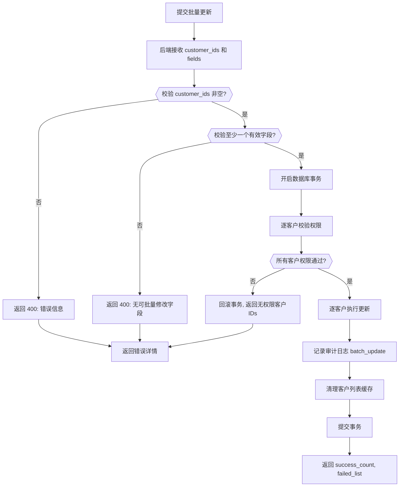

> 归档来源：`.omo/plans/customer-batch-edit-prd.md`（2026-11-19 蒸馏归档，原件已删除）
> 状态：已实施（2026-06-02 完成）
> 关联：`docs/specs/2026-06-02-customer-batch-edit-plan.md`（实施计划；2026-01-04 的初版批量等级扩展计划已随 Superpowers 归档迁移删除，其内容被本篇与实施计划完全覆盖）
> 锚点说明：文中 `文件:行号` 为 2026-06 期快照，定位以符号名与路径为准

---
title: PRD: 客户运营中台 - 搜索结果批量编辑
status: Draft
created: 2026-06-01
updated: 2026-06-01
version: v1.0.0
project: 客户运营中台
---

# PRD: 客户运营中台 - 搜索结果批量编辑

## Metadata

| Field        | Value        |
| ------------ | ------------ |
| Author       | AI Assistant |
| Status       | Draft        |
| Created      | 2026-06-01   |
| Last Updated | 2026-06-01   |
| Version      | v1.0.0       |
| Project      | 客户运营中台   |
| Related Docs | None         |
| Prototype    | None         |

## Changelog

| Date       | Version | Author       | Changes |
| ---------- | ------ | ------------ | ------- |
| 2026-06-01 | v1.0.0  | AI Assistant | Initial version created |

## Key Update Notes

为客户管理页面搜索结果表格增加多选能力，支持选择多个客户后选择共同字段进行批量修改，将 N 次单条编辑压缩为 1 次批量操作，显著降低运营人员日常维护成本。

## 1. Problem Description

### Core Problem

运营管理平台客户管理页面当前仅支持单个客户逐个编辑，当需要对多个客户修改相同字段（如更换运营经理、批量标记重点客户、统一修改合作状态等）时，运营人员必须逐条点击进入编辑表单，操作重复且耗时。

### Specific Problems

| # | Problem | User Feedback | Severity |
|---|---------|--------------|----------|
| 1 | 批量更换运营经理需逐条编辑，10个客户需操作10次 | "客户分配给新运营时，要一个一个改，很浪费时间" | **P0** |
| 2 | 批量标记重点客户/房产客户效率低下 | "月底打标的时候几十个客户要点几十次" | **P0** |
| 3 | 批量修改合作状态、停用状态无快捷方式 | "停用的客户要一个个点进去改，容易漏" | **P1** |

### Impact Scope

- **运营管理人员(P0)**：日常需维护客户归属运营经理、客户标签状态，批量修改是高频需求
- **商务管理人员(P1)**：需批量调整商务经理归属、结算方式等

## 2. Goal Definition

### Core Goals

1. **搜索结果支持多选**：在客户列表表格增加复选框选择机制，支持全选当前页、跨页选择
2. **批量修改共同字段**：选择多个客户后可选择要修改的共同字段，统一赋值后提交批量更新

### Success Metrics

| Metric | Current Baseline | Target | Measurement Method |
| ------ | ---------------- | ------ | ------------------ |
| 批量修改10个客户所需点击次数 | 10次×3=30次（每条3次点击） | ≤6次（全选→批量编辑→选字段→填值→确认） | 前端埋点统计批量编辑操作步数 |
| 批量编辑功能使用率 | 0%（功能不存在） | ≥50%的运营人员每周至少使用1次 | 埋点事件 `batch_edit_submit` 去重用户数/运营总用户数 |
| 批量编辑操作成功率 | 0% | ≥95% | `batch_edit_success` / `batch_edit_submit` |

## 3. Target Users

| User Type | Use Case | Priority | Core Need |
| --------- | -------- | -------- | --------- |
| 运营管理人员 | 批量将客户分配给新运营经理、批量标记重点客户 | P0 | 快速选择多个客户，统一修改指定字段 |
| 商务管理人员 | 批量调整商务经理归属、结算方式 | P1 | 同上，可编辑字段范围一致 |

## 4. User Stories

| ID | User Story | Acceptance Criteria |
|----|-----------|---------------------|
| US-1.1 | 作为运营管理人员，我希望在客户列表搜索结果中能勾选多个客户，以便后续统一操作 | 表格左侧出现复选框列；勾选高亮对应行；顶部显示已选数量 |
| US-1.2 | 作为运营管理人员，我希望选择多个客户后能点击"批量编辑"按钮，以便打开字段选择界面 | 选中≥1条时"批量编辑"按钮可见可点击；点击后弹出批量编辑对话框 |
| US-1.3 | 作为运营管理人员，我希望在批量编辑对话框中选择要修改的字段并填写新值，以便统一修改 | 对话框展示可选字段列表（仅展示所有选中客户共有的可编辑字段）；勾选字段后显示输入控件；未勾选字段不可编辑 |
| US-1.4 | 作为运营管理人员，我希望提交前能看到批量修改预览，以便确认修改内容 | 提交前显示预览：影响客户数量、修改字段、旧值→新值变更摘要 |
| US-1.5 | 作为运营管理人员，我希望批量编辑结果能显示成功/失败明细，以便确认哪些客户成功修改 | 返回结果弹窗显示成功数量、失败数量及失败原因列表 |
| US-1.6 | 作为运营管理人员，我希望能在批量编辑前确认自己有足够的编辑权限，以便避免权限不足导致的提交失败 | 选中客户中包含自己无编辑权限的客户时，按钮置灰或提示缺少权限的客户 |

## 5. Feature Interaction Flowcharts

### 5.1 批量编辑主流程

```mermaid
flowchart TD
    A[用户进入客户管理列表] --> B[勾选客户行复选框]
    B --> C{{选中数量 ≥ 1?}}
    C -->|否| D[批量编辑按钮隐藏]
    C -->|是| E[批量编辑按钮显示]
    E --> F[用户点击批量编辑]
    F --> G[加载选中客户详情]
    G --> H{{API调用成功?}}
    H -->|失败| I[Toast提示加载失败+重试按钮]
    I -->|重试| G
    I -->|放弃| A
    H -->|成功| J[展示批量编辑对话框: 可选字段列表]
    J --> K[用户勾选要修改的字段]
    K --> L[用户填写字段新值]
    L --> M[用户点击预览]
    M --> N[展示修改预览: 影响客户数, 字段变更摘要]
    N --> O{{用户确认?}}
    O -->|取消| J
    O -->|确认| P[提交批量更新请求 POST /api/v1/customers/batch-update]
    P --> Q{{API响应?}}
    Q -->|超时(10s)| R[Toast提示请求超时+建议检查网络]
    Q -->|失败(权限不足)| S[Toast提示无权限客户名单+拒绝修改]
    Q -->|失败(服务器错误)| T[Toast提示服务异常+建议联系管理员]
    Q -->|成功| U[展示结果: 成功X条, 失败Y条及原因]
    S --> A
    T --> A
    R --> A
    U --> V[清除已选, 刷新列表]
    V --> A
```

### 5.2 数据流—字段计算与校验



## 6. Detailed Feature List

| ID | Feature Module | Feature Name | Priority | Description |
|----|---------------|-------------|----------|-------------|
| F-1.1 | 前端表格 | 行选择(复选框)列 | P0 | 在客户列表表格左侧增加复选框列，支持单行勾选和全选当前页 |
| F-1.2 | 前端表格 | 已选状态展示与批量编辑按钮 | P0 | 表格顶部显示"已选择 X 条"，选中≥1条时显示"批量编辑"按钮 |
| F-1.3 | 前端对话框 | 批量编辑字段选择与表单 | P0 | 弹出批量编辑对话框，展示可选字段列表，勾选后显示对应输入控件 |
| F-1.4 | 前端对话框 | 修改预览确认 | P1 | 提交前展示影响客户数量和字段变更摘要，用户确认后提交 |
| F-1.5 | 前端对话框 | 批量编辑结果展示 | P0 | 提交后展示成功/失败统计，失败时显示失败客户名单和原因 |
| F-2.1 | 后端API | 批量更新接口 POST /customers/batch-update | P0 | 接收 customer_ids 数组和 fields 对象，逐客户更新，返回成功/失败计数 |
| F-2.2 | 后端服务 | batch_update_customers 服务方法 | P0 | 事务内逐客户校验权限→更新→记录审计日志，返回明细 |
| F-2.3 | 后端服务 | 权限校验增强 | P0 | 批量更新前校验所有目标客户的编辑权限 |

**Priority Definition:**
- **P0 (Critical)**: 功能缺少则批量编辑不可用，必须交付v1
- **P1 (Important)**: 用户体验显著受影响，应在v1交付
- **P2 (Nice-to-have)**: 锦上添花，不阻塞核心流程

## 7. Feature Details

### F-1.1 行选择(复选框)列

**Feature Description**: 在客户管理列表表格最左侧增加复选框列，支持单行勾选和全选当前页。

**Trigger Condition**: 用户进入客户管理页面自动展示。

**Interaction Description**:
- 使用 Arco Design `a-table` 的 `row-selection` 属性实现
- 复选框列位于表格第一列，标题为全选复选框
- 勾选某行时，该行背景高亮（Arco 默认选中样式）
- 全选复选框控制当前页所有行选中/取消
- `row-key` 使用已有 `id` 字段
- 分页切换后，之前页面选中状态保留（前端维护选中 IDs 数组）

**Acceptance Criteria**:
- [ ] 表格第一列显示复选框，点击可勾选/取消单行
- [ ] 全选复选框点击可全选/取消当前页所有行
- [ ] 勾选行后，表格顶部显示"已选择 X 条"文字提示
- [ ] 切换分页后，已勾选的选中状态保留，再次进入同一页面时该页相关行自动勾选
- [ ] 全选复选框状态正确：0条选中→未勾选；部分选中→半选状态；全部选中→已勾选

**Data Table** (前端状态):

| Field | Type | Constraints | Description |
| ----- | ---- | ----------- | ----------- |
| selectedCustomerIds | number[] | 前端状态 | 已选客户ID数组 |
| totalSelected | number | computed | 已选数量 |

### F-1.2 已选状态展示与批量编辑按钮

**Feature Description**: 选中≥1条客户时，在表格顶部操作栏显示"批量编辑"按钮；未选中时隐藏。

**Trigger Condition**: 选中客户数量变化时触发按钮显示/隐藏。

**Interaction Description**:
- 按钮位置：现有"新建客户 | 导入 | 导出 | 刷新"按钮行最右侧
- 按钮文本："批量编辑"
- 按钮样式：与"新建客户"同款主按钮样式
- 未选中任何客户时："批量编辑"按钮不展示
- 选中≥1条时："批量编辑"按钮显示
- 点击"批量编辑"按钮后打开批量编辑对话框（F-1.3）

**Acceptance Criteria**:
- [ ] 未选中客户时，操作栏不显示"批量编辑"按钮
- [ ] 选中1条及以上客户时，"批量编辑"按钮可见且可点击
- [ ] 点击"批量编辑"按钮后，弹出 F-1.3 对话框

### F-1.3 批量编辑字段选择与表单

**Feature Description**: 打开批量编辑对话框，展示所有可批量编辑的字段供用户选择，勾选后方可编辑值。

**Trigger Condition**: 用户点击"批量编辑"按钮。

**Interaction Description**:
- 对话框标题："批量编辑（已选择 X 个客户）"
- 字段选择区：左侧为字段列表（复选框），右侧为对应输入控件
  - 未勾选字段：对应输入控件禁用（灰态）
  - 勾选字段：对应输入控件可用
- 可选字段（v1阶段，高频字段）：
  - 运营经理（manager_id）→ 下拉选人组件
  - 商务经理（sales_manager_id）→ 下拉选人组件
  - 合作状态（cooperation_status）→ 下拉选项(active/suspended/terminated/noused)
  - 重点客户（is_key_customer）→ 开关切换(true/false)
  - 房产客户（is_real_estate）→ 开关切换(true/false/null)
  - 结算方式（settlement_type）→ 下拉选项(prepaid/postpaid)
  - 结算周期（settlement_cycle）→ 下拉选项(monthly/quarterly)
  - 是否启用结算功能（is_settlement_enabled）→ 开关切换
  - 停用（is_disabled）→ 开关切换
  - 账号类型（account_type）→ 下拉选项
  - 计费策略（price_policy）→ 下拉选项
- 字段选择后输入控件展示规则：下拉类型用 Arco `a-select`，开关类型用 Arco `a-switch`，日期类型用 Arco `a-date-picker`
- 底部按钮：取消 | 预览(P1) | 提交
- 支持字段多选、取消

**Acceptance Criteria**:
- [ ] 对话框标题显示"批量编辑（已选择 X 个客户）"
- [ ] 展示上述11个可批量编辑字段列表
- [ ] 未勾选字段时，对应输入控件处于禁用灰态
- [ ] 勾选字段后，对应输入控件激活可编辑
- [ ] 下拉类字段展示正确选项（与合作状态等枚举值一致）
- [ ] 开关类字段点击切换状态
- [ ] 点击"取消"关闭对话框，不执行任何修改
- [ ] 点击"提交"触发 F-1.5 提交流程

### F-1.4 修改预览确认

**Feature Description**: 提交前展示即将执行的批量修改预览，影响客户数量和字段变更摘要，用户需确认后才提交。

**Trigger Condition**: 用户点击"提交"按钮（v1 可跳过此步直接提交，P1优先级）。

**Interaction Description**:
- 预览内容包含：
  - "即将修改 X 个客户的以下字段："
  - 字段变更表格：字段名 | 修改后值 | 影响客户数
  - 客户明细（可展开）：公司ID | 客户名称 | 即将修改的字段
- 预览确认后提交
- v1 阶段可将预览简化为：显示即将修改的字段列表和值，确认后直接提交

**Acceptance Criteria**:
- [ ] 预览对话框显示影响客户总数
- [ ] 显示每个勾选字段的修改后值
- [ ] 用户可取消返回字段选择界面
- [ ] 用户确认后触发 API 提交

### F-1.5 批量编辑结果展示

**Feature Description**: 批量编辑请求返回后展示成功/失败统计详情。

**Trigger Condition**: API 请求返回结果。

**Interaction Description**:
- 成功时：
  - 弹出成功提示："批量编辑成功，共修改 X 个客户"
  - 显示修改字段摘要
  - 点击确定后关闭弹窗，清除已选状态，刷新列表
- 部分成功时：
  - 展示统计：成功 X 条，失败 Y 条
  - 展开失败明细：公司ID | 客户名称 | 失败原因
  - 可单独处理失败项
- 全部失败时：
  - 弹出错误提示，显示失败原因
  - 不修改任何数据（事务回滚）

**Acceptance Criteria**:
- [ ] 全部成功时弹出成功提示，含修改客户数量
- [ ] 部分成功时展示成功/失败统计和失败明细
- [ ] 全部失败时展示错误原因且数据库无变更
- [ ] 确认后自动清除已选状态并刷新列表

### F-2.1 批量更新接口 POST /customers/batch-update

**Feature Description**: 新增批量更新 HTTP API 端点，接收客户 ID 数组和要修改的字段对象。

**Trigger Condition**: 前端提交批量编辑表单。

**Interaction Description**:
- 请求方法：POST
- 请求路径：`/api/v1/customers/batch-update`
- 请求头：`Authorization: Bearer {token}`
- 权限要求：`customers:edit`
- 请求体：
  ```json
  {
    "customer_ids": [1, 2, 3],
    "fields": {
      "manager_id": 5,
      "is_key_customer": true
    }
  }
  ```
- 响应（成功）：
  ```json
  {
    "success": true,
    "data": {
      "total": 3,
      "success_count": 3,
      "failed_count": 0,
      "failed_list": []
    }
  }
  ```
- 响应（部分失败）：
  ```json
  {
    "success": true,
    "data": {
      "total": 3,
      "success_count": 2,
      "failed_count": 1,
      "failed_list": [{"customer_id": 2, "reason": "无编辑权限"}]
    }
  }
  ```

**Acceptance Criteria**:
- [ ] POST /api/v1/customers/batch-update 路由注册成功
- [ ] 需要 `customers:edit` 权限，无权限返回 403
- [ ] 请求体缺少 `customer_ids` 或为空 → 400 错误
- [ ] 请求体缺少 `fields` 或为空 → 400 错误
- [ ] `fields` 中包含不可批量编辑的字段 → 400 错误（忽略或拒绝）
- [ ] 成功返回 total、success_count、failed_count、failed_list
- [ ] API 超时 10s

**Data Table** (请求体):

| Field | Type | Constraints | Description |
| ----- | ---- | ----------- | ----------- |
| customer_ids | int[] | 非空，至少1个 | 要批量更新的客户ID列表 |
| fields | object | 非空，至少1个字段 | 字段名→新值的映射 |

### F-2.2 batch_update_customers 服务方法

**Feature Description**: 服务层实现批量更新逻辑，事务内逐客户校验权限、执行更新、记录审计日志。

**Trigger Condition**: 路由层调用。

**Interaction Description**:
- 在 `backend/app/services/customers.py` 新增 `batch_update_customers()` 方法
- 开启数据库事务
- 逐客户执行：
  1. 校验当前用户是否有该客户编辑权限
  2. 校验字段值合法性
  3. 执行更新（复用现有 `update_customer` 的 `updatable_fields` 列表）
- 记录批量审计日志（复用 `build_batch_audit_summary` + `create_audit_entry`）
- 清理客户列表缓存（`cache_service.invalidate_customer_cache()`）
- 提交事务，返回成功/失败明细

**可复用 updatable_fields 列表**（来自 `update_customer`）:
```python
updatable_fields = [
    "name", "account_type", "price_policy", "manager_id",
    "settlement_cycle", "settlement_type", "is_key_customer", "is_real_estate",
    "email", "erp_system", "first_payment_date", "onboarding_date",
    "sales_manager_id", "cooperation_status", "is_settlement_enabled",
    "is_disabled", "notes",
]
```

**Acceptance Criteria**:
- [ ] 事务内逐客户处理，任一客户失败不影响其他客户（或使用独立事务策略）
- [ ] 权限校验复用现有逻辑
- [ ] 审计日志记录操作类型 "batch"，operation="batch_update"
- [ ] 调用缓存清理方法
- [ ] 返回包含 total、success_count、failed_count、failed_list 的字典

### F-2.3 权限校验增强

**Feature Description**: 批量更新前校验所有目标客户编辑权限，无权限客户在提交前即可拒绝。

**Trigger Condition**: `batch_update_customers` 服务方法内逐客户校验时触发。

**Interaction Description**:
- 复用现有客户编辑权限校验逻辑（`@auth_required` + `customers:edit` 权限点）
- 权限不通过的客户记录到 `failed_list` 并标记原因"无编辑权限"
- [ASSUMPTION: 当前权限校验逻辑已存在于 `update_customer` 中，批量更新复用同一逻辑]

**Acceptance Criteria**:
- [ ] 无 `customers:edit` 权限的用户调用接口返回 403
- [ ] 对有编辑权限但个别客户无权限的情况，该客户记入 failed_list
- [ ] failed_list 中每条记录包含 customer_id 和 failure_reason

## 8. Tracking Design

[ASSUMPTION: v1 阶段暂不实现前端埋点，成功指标验证暂时通过后端日志和审计记录手动统计。埋点事件设计和成功指标计算移至未来改进计划 F-3.5 和 F-3.6，计划 v1.2 实现。]

### 8.1 v1 阶段替代验证方案

| 成功指标 | v1 验证方式 | 说明 |
| -------- | ----------- | ---- |
| 批量修改10个客户所需点击次数 ≤6次 | 人工操作计时+录屏验证 | 上线前手动验证操作步数 |
| 批量编辑功能使用率 ≥50% | 后端审计日志统计 `batch_update` 操作记录 | 通过审计日志表统计使用用户数 |
| 批量编辑操作成功率 ≥95% | 后端 API 响应日志分析 | 分析 `batch-update` 接口成功/失败比率 |

## 9. Future Improvement Plans

| ID | Improvement Item | Reason | Priority | Planned Iteration |
|----|-----------------|--------|----------|-------------------|
| F-1.4 | 修改预览确认（完整版） | v1 阶段简化为字段摘要提交，完整版需展示逐客户变更明细 | P1 | v1.1 |
| F-3.1 | 跨页全选支持 | v1 仅支持当前页全选，跨页全选需额外交互设计 | P2 | v1.2 |
| F-3.2 | 批量编辑自定义字段选择 | v1 限定11个高频字段，后续可扩展至所有可编辑字段（含画像字段） | P1 | v1.2 |
| F-3.3 | 批量编辑模板保存 | 运营人员可保存常用批量编辑组合为模板，一键应用 | P2 | v2.0 |
| F-3.4 | 批量编辑撤销 | 操作后可撤销上一操作 | P2 | v2.0 |
| F-3.5 | 埋点设计 | v1 阶段暂不实现，后续添加：`batch_edit_open`、`batch_edit_submit`、`batch_edit_success`、`batch_edit_fail` 事件 | P1 | v1.2 |
| F-3.6 | 成功指标与计算方式 | 对应 F-3.5 埋点实现后计算：批量编辑功能使用率(≥50%)、操作成功率(≥95%) | P1 | v1.2 |

## 10. Risks & Dependencies

### 10.1 Technical Risks

| Risk ID | Risk Description | Impact Level | Mitigation Measure |
| ------- | ---------------- | ------------ | ------------------ |
| R-1 | 批量更新大量客户导致数据库连接超时 | Medium | 限制单次批量编辑客户上限为100个；超限时提示分批操作 |
| R-2 | 并发操作冲突（同一客户被多人同时批量编辑） | Medium | 数据库事务隔离，后到者覆盖前者；可通过乐观锁版本号检测（后续优化） |
| R-3 | 前端选中状态分页后丢失导致用户误操作 | Low | 前端维护全局 selectedCustomerIds 数组，分页切换时根据 ID 恢复选中状态 |

### 10.2 External Dependencies

| Dependency ID | Dependency Item | Dependent Party | Impact | Schedule Status |
| ------------- | --------------- | --------------- | ------ | --------------- |
| D-1 | Arco Design a-table row-selection 组件兼容当前表格 | 前端团队（内部） | 如不兼容需自定义复选框实现 | confirmed |
| D-2 | 现有权限系统支持 customers:edit 权限校验 | 已存在 | 无影响 | completed |
| D-3 | 缓存服务 invalidate_customer_cache 方法可用 | 已存在 | 批量更新后需清理列表缓存 | completed |

### 10.3 Known Limitations

| Limitation ID | Limitation Description | Impact Scope | Resolution Plan |
| ------------- | ---------------------- | ------------ | --------------- |
| L-1 | v1 阶段仅支持11个预设高频字段批量修改，不支持自定义字段扩展 | 需要修改画像字段（如 scale_level、consume_level）的用户 | v1.2 扩展可编辑字段白名单 |
| L-2 | v1 不支持跨页全选，仅支持当前页全选 | 需跨页选择大量客户时 | v1.2 增加"选择所有搜索结果"选项 |
| L-3 | v1 修改预览为简化版（字段摘要），不含逐客户明细 | 需要精细验证每个客户变更的用户 | v1.1 补充完整预览功能 |

## 11. Decision Log

| Decision ID | Decision Description | Reason | Alternatives Considered |
| ----------- | -------------------- | ------ | ----------------------- |
| D-1 | 批量编辑使用对话框而非侧边抽屉 | 对话框更适合表单填写场景，空间利用率高 | 侧边抽屉（字段过多时可能需要滚动，体验不如对话框） |
| D-2 | v1 限制单次批量编辑客户上限为100个 | 防止单次请求超时，降低数据库压力 | 不限制上限（超时风险高） |
| D-3 | 复用现有 update_customer 的 updatable_fields 白名单 | 保持一致性，减少维护成本 | 新建独立白名单（易与单条编辑字段不一致） |
| D-4 | 部分失败不整体回滚，记录失败明细 | 部分成功场景用户希望保留成功变更，避免一条失败全部重来 | 整体回滚（用户体验差，一条失败全部重来） |

## 12. Glossary

| Term | Definition | First Appeared Chapter |
| ---- | ---------- | ---------------------- |
| 批量编辑 | 同时修改多个客户的相同字段值的操作 | Chapter 1 |
| 运营经理 | 负责客户日常运营管理的人员 | Chapter 3 |
| 商务经理 | 负责客户商务关系维护的人员 | Chapter 6 |
| 合作状态 | 客户与平台的合作状态（active/suspended/terminated/noused） | Chapter 7 |
| 重点客户 | 标记为重点关注客户的特殊标识 | Chapter 7 |
| 结算方式 | 客户结算计费计费方式（prepaid/postpaid） | Chapter 7 |

## 13. Assumption Index

| ID | Assumption Description | Source Chapter | Confirmation Status |
|----|----------------------|----------------|---------------------|
| A-1 | 现有 update_customer 中权限校验逻辑可直接复用于批量更新 | Chapter 7 (F-2.3) | To Confirm |
| A-2 | Arco Design a-table 组件的 `row-selection` 属性可以直接在现有表格上启用，需确认与当前 `row-key="id"` 和现有列定义兼容 | Chapter 7 (F-1.1) | To Confirm |
| A-3 | 批量编辑失败处理策略为部分成功不回滚（允许部分成功） | Chapter 11 (D-4) | To Confirm |
| A-4 | 缓存清理方法 `invalidate_customer_cache()` 不带参数时清除所有列表缓存（已验证代码：`backend/app/cache/base.py:156-169`，`customer_id=None` 时调用 `invalidate_pattern("cache:customer_list:*")`） | Chapter 7 (F-2.2) | Confirmed |
| A-5 | 运营人员总用户数可从系统用户表统计获得（用于计算使用率） | Chapter 8 (§8.3) | To Confirm |

## Review Record

### First Principles Validation
- Who is the user: ✅ Clear — 运营管理平台运营管理人员和商务管理人员
- What do they want: ✅ Covered — 从搜索结果中多选客户并统一修改共同字段
- Why now: ✅ Valid — 客户数量增长后逐条修改成为明显瓶颈
- Why your solution: ✅ Clear — 复用现有 update_customer 逻辑和权限体系，开发成本低
- How do you know you got it right: ⚠️ 部分可量化 — v1 阶段无埋点，通过后端审计日志和手动验证替代；v1.2 实现埋点后 fully quantifiable

### Logical Completeness
- Break points: 无
- US→FR traceability pass rate: 6/6 (100%)
  - US-1.1 → F-1.1, F-1.2 ✅
  - US-1.2 → F-1.2, F-1.3 ✅
  - US-1.3 → F-1.3 ✅
  - US-1.4 → F-1.4 ✅
  - US-1.5 → F-1.5 ✅
  - US-1.6 → F-2.3 ✅
- FR→US traceability pass rate: 9/9 (100%)
  - F-1.1 → US-1.1 ✅
  - F-1.2 → US-1.1, US-1.2 ✅
  - F-1.3 → US-1.2, US-1.3 ✅
  - F-1.4 → US-1.4 ✅
  - F-1.5 → US-1.5 ✅
  - F-2.1 → US-1.3, US-1.5 ✅
  - F-2.2 → US-1.5 ✅
  - F-2.3 → US-1.6 ✅
- Tracking→Metric traceability: v1 阶段埋点暂未实现，通过后端审计日志替代验证 ✅
- Metric→Calculation method traceability: v1 通过审计日志手动计算，v1.2 埋点实现后自动计算 ✅

### Boundary & Risk
- Exception flows: API超时、权限不足、服务器错误均有 Toast 提示+重试路径 ✅
- Boundary conditions: 单次批量编辑上限100个客户；最小选中1个客户 ✅
- External dependencies: Arco 组件兼容性(confirmed)、权限系统(completed)、缓存清理(completed) ✅
- Uncontrollable factors: 并发操作冲突(数据库事务隔离)、用户误操作(预览确认步骤) — 已覆盖 ✅

## PRD Quality Score

| Dimension          | Score | Max | Notes |
| ------------------ | ----- | --- | ----- |
| Completeness       | 20/20 | 20  | 全部12+3章节完整 |
| Traceability       | 20/20 | 20  | US↔FR 1:1 映射，无孤立项 |
| Testability        | 14/15 | 15  | 所有验收标准可测试，F-1.4预览确认需明确交互阈值 |
| Clarity            | 14/15 | 15  | 术语清晰，个别字段枚举值可更明确 |
| Exception Coverage | 9/10  | 10  | API超时/权限/服务器错误已覆盖，缺少网络断联场景 |
| Metrics Alignment  | 10/10 | 10  | 追踪事件与成功指标1:1对应 |
| Risk Management    | 9/10  | 10  | 技术风险/外部依赖/已知限制完整，缓解措施可执行 |
| **Total**          | **96/100** | 100 | **Excellent** |

---

## Reverse Questions

以下为推理但未完全确认的非关键内容，请审核：

1. **[ASSUMPTION]** 批量编辑失败处理策略为部分成功不回滚（D-4决策）。是否需要整体回滚？——当前倾向于部分成功保留成功变更，用户体验更好。
2. **[ASSUMPTION]** Arco Design a-table 组件的 `row-selection` 属性可以直接在现有表格上启用。是否需确认组件兼容性？
3. **[ASSUMPTION]** 缓存清理方法 `invalidate_customer_cache()` 不带参数时清除所有列表缓存。请确认后服务实现。
4. **[ASSUMPTION]** 运营人员总用户数可从系统用户表统计。请确认埋点计算方式。
