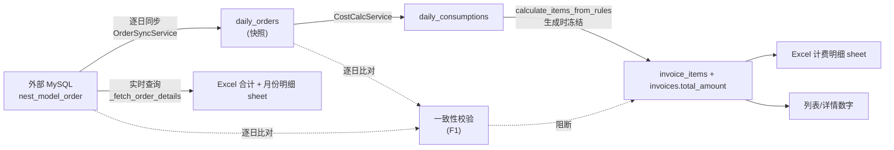
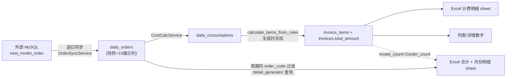

# 结算单明细数据一致性修复 — 技术方案（终版）

> 2026-11-05 与用户确认定稿；**2026-11-10 对照当前代码（分支 `fix/invoice-consistency`，工作区未提交态）逐条修订**。
>
> 定稿范围 = 一致性 + 同步层根治；快照与外部不一致时**拒绝生成并提示重新同步**；历史脏数据本次不动。
>
> **落地后的三处范围演进**（本篇已按当前代码改写，根因章节保持历史事实原样）：
> 1. **F1（生成前外部实时比对）已实现后又移除**——F9 把「月份明细」改为本地快照后，三表断点从根源消除，该阻断失去存在意义；
> 2. **F2 由「实时查外部 + 订单号过滤」演进为「读 `daily_orders` 本地快照」**（F9），Excel 生成零外部依赖；
> 3. 落地过程中**新增多层计费两列冻结、房源级识别键（F7）**，编号与 `.trellis/spec/backend/invoice-consistency.md` 契约（覆盖 F2–F8 + 多层冻结）对齐。

---

## 一、根因（已用生产库 + 外部 MySQL 实证）

### 1.1 计数不一致：合计 233 vs 计费明细 228

两个数字来自**两个独立数据源、两个不同时间点**：

| 数字 | 来源链路 | 取数时刻 |
|---|---|---|
| 模型总数量 / 计费模型数量 = **233** | Excel「合计」sheet ← `InvoiceExcelService._build_and_save_excel` 的 `model_count = len(order_details)` ← `_fetch_order_details()` **实时查外部 MySQL** `nest_model_order` | 明细生成时（2026-11-02） |
| 单层 207 + 多层 21 = **228** | Excel「计费明细」sheet ← 冻结的 `InvoiceItem` ← `BillingService.calculate_items_from_rules()` ← `daily_consumptions` ← `daily_orders` | 订单同步时（2026-10-31 15:21 CST） |

**钱是按 10-31 下午的快照算的，模型数是 11-02 现查的。** 差额 5 = `+10 漏算 − 4 过期 − 1 重复`：

- **+10 笔漏算**：10-31 当天 15:20 手动跑同步（SyncTask `01d5f598`，`sync_task_logs` id 181）时，外部库该客户（`group_type=1543`）当天只有 7 笔可结算订单；随后 10 笔在 UTC 07:43–09:59（CST 15:43–17:59）才上传完成，**此后再没有人重跑过 10-31** → `daily_orders` / `daily_consumptions` 冻结在 228。
- **−4 笔过期**：`OPPD_umq41792286528`、`maoZ1792658327`、`OPPD_SzPT1792661234`、`wsRd1793421087` 的 `upload_date` 事后被改到 2026-11-01，但 `OrderSyncService._clear_orders()` 只清「当天」的旧行，不回溯清理 10-24/10-30 的残留 → 10 月快照里仍留着它们。
- **−1 笔重复**：`OPPD_SzPT1792661234` 在 `daily_orders` 里同时存在 10-24 和 10-30 两行。实测 `count(*)=228`、`count(distinct order_code)=227`，唯一约束是 `(order_code, sync_date)`，同一订单跨日会被计两次。

### 1.2 为什么没人发现：三道防线全失效

1. `sync_schedule_configs` 中 `daily_sync` **`enabled = f`** —— 每日自动同步是关的，10 月全靠手动补同步。
2. `skip_existing` 模式下 `SyncTaskService._check_data_completeness()` 只要「当天已有订单 + 已有费用」就整体跳过 → **无论重跑多少次都修不回 10-31**（对应 F6-1，已修；注意该判据只查行数存在性，不查展示列是否为 NULL，见 F9 回填边界）。
3. 结算单生成、明细生成全链路**没有任何地方比对「冻结快照量」与「外部实时量」**，233 vs 228 被静默交付。

### 1.3 金额不一致：`InvoiceItem` 不存 subtotal

`InvoiceItem` 只有 `quantity` / `unit_price`，模型注释写着 `# subtotal = quantity * unit_price` —— 这对**多层递增（incremental）**模式是错的：

```
真实小计 = order_count × unit_price + (total_floor_count − order_count) × additional_floor_price
落库值   quantity = total_floor_count, unit_price = unit_price
```

`invoice_excel.py` 的「计费明细」sheet 又用 `subtotal = quantity * unit_p` 重算一遍，于是明细小计合计 ≠ `invoices.total_amount`。

**实证**：`sum(invoice_items.quantity × unit_price)` 与 `invoices.total_amount` 不符的共 2 张，全是常州我爱我家（customer 27544）：

| invoice | total_amount | items_sum | diff |
|---|---|---|---|
| 1448 `INV-20261102-27544-WN0B` | 6748.00 | 6874.00 | −126.00 |
| 1650 `INV-20261102-27544-OETC` | 6748.00 | 6874.00 | −126.00 |

其规则为 `fixed / L / multi / unit_price=14 / incremental / additional_floor_price=11`：78 单 120 层，`3 × (120−78) = 126`。

### 1.4 已排除的假设

**不存在 8 小时时区偏移。** 实证：272 笔 `upload_date` UTC 16:00 之后的订单，`daily_orders.sync_date` 全部 = 自然日 +1 天；`local_date_to_utc_start()` 产生的 aware UTC datetime 经 pymysql 以 UTC 墙钟渲染，日/月边界与 CST 严格对齐。`invoices.period_start` 实测存的是 `2026-09-30 16:00:00Z`（= CST 10-01 00:00），`period_end` = `2026-10-31 15:59:59Z`，与逐日同步窗口完全重合（两种窗口实测都返回 233 行）。同步与 Excel 用的是同一套正确窗口。

### 1.5 其它确认无问题项

- `DETAIL_SQL` 未按客户过滤，只按 `group_type`。实测 `group_type=1543` 下 `count(distinct owner_company)=1`，当前数据 1:1 无泄漏；属潜在脆弱点，不在本次改。
- `POST /invoices/<id>/regenerate-detail` 全仓仅一处定义，带 `@require_permission("billing:detail_regenerate")`，无重复注册。**当前行号 `routes/billing/invoices.py:2682`**（另有批量版 `regenerate-detail-batch` 在 2635 行；定稿时记载的 2644 已因后续提交漂移）。

---

## 二、数据链路

定稿时的链路（G 支线为断点所在）：



断点在 G 与 D 之间没有对齐，也在 D 与 F 之间（详情抽屉实时重算）。

**终版实际链路**（F9 后 G 支线整体移除，改由 B 供数；F1 随之移除）：



三表（合计 / 月份明细 / 计费明细）现均从冻结快照与 `daily_orders` 本地快照派生，**Excel 生成零外部依赖**；外部实时漂移只影响后续同步，不再影响已生成文件。

---

## 三、设计原则

1. **钱和量只能有一个口径**：`invoices.total_amount` 与 `invoice_items` 是唯一权威（冻结快照）。任何展示层都从它派生，不允许二次实时计算。
2. **不一致必须在交付前被拦住**，而不是写进文件后靠人发现。
3. **修复动作必须可执行**：报错信息要能直接告诉运营「重同步哪几天」，而不是「请检查数据」。

> 原则 2 的落地方式随范围演进调整：定稿设计为「生成前外部实时比对阻断」（F1）；终版以「同源快照 + 生成时冻结」在结构上保证一致——月份明细与计费明细同源于本地快照后，时点漂移不再可能进入交付物。

---

## 四、改动清单（原设计 → 最终落地）

### F1 生成前一致性校验 — **已实现后又移除**

原设计（162 行服务 + 216 行单测，commit `f85dd9a`）：新增 `backend/app/services/invoice_consistency.py`，`diff_period()` 按 CST 日分桶逐日比对外部 `nest_model_order` 与本地 `daily_orders`；外部库不可达返回 `None` 放行；接入 `generate_invoice()` / `generate_invoices_batch()` / 路由层，不一致时拒绝生成或进 `skipped`，文案含客户名 + 差异日期清单（例：只需重同步 `2026-10-31`）。

**移除状态**：当前工作区已删除 `backend/app/services/invoice_consistency.py` 与 `backend/tests/unit/test_invoice_consistency.py`（`git status` 显示两条 `D`，未提交；HEAD 中仍存在）。

**移除理由**：F9 将「月份明细」改为读 `daily_orders` 本地快照后，原断点（外部实时 vs 本地冻结）不复存在——「合计」「月份明细」「计费明细」三表同源于快照，生成前再查一次外部 MySQL 既不能提升一致性，又把外部系统可用性绑到出账关键路径（RDS 白名单/IP 抖动直接卡住全部客户出账）。契约文档同步将覆盖范围定为 F2–F8（不含 F1）。

**保留价值**：`diff_period` 的 CST 分桶口径（`+ INTERVAL 8 HOUR` 折算、`local_date_to_utc_start` 同窗）与 272 笔 16:00 边界样本的验证方法，仍是排查同步缺数问题的参照。

### F2 明细 Excel 三表同源 — **已实现，形态演进为 F9 快照化**

原设计：`_fetch_order_details()` 增加 `order_codes` 参数做 Python 侧过滤；`model_count = Σ order_count`；差异写「合计」备注列兜底。

最终落地（超出原设计）：

- `_build_and_save_excel()` 新增 `order_details` 入参，**由调用方从 `daily_orders` 本地快照提供**（`invoice_excel.py:135/148`；`None` 时保持旧行为）；「月份明细」sheet 直接由这些行渲染（`:470`）。
- `model_count` 取冻结列 `Σ order_count`（`:413`），与「计费明细」同源。
- 差异兜底：`external_count = len(order_details)` 与 `model_count` 比对，差异写「合计」备注列（`:437-440）——正常链路恒等，异常时可见。
- 外部 MySQL 查询整体移除：`tasks/invoice_detail_generator.py` 按 `invoice.customer_id + 周期 + order_code ∈ items.order_codes` 查 `daily_orders`（`:160-185`，`_order_row_to_dict` 转 26 键）；集合为空 → 月份明细空表，与「合计 0 套」自洽。
- 19 个展示列 + 原值 datetime 由迁移 `i4j5k6l7m8n9` 加到 `daily_orders`（可空不回填；dev 库用 `backend/scripts/backfill_daily_order_detail_columns.py` 回填外部仍在的数据，**一次性脚本、不进 deploy 流程**）。

### F3 `invoice_items` 增加 `subtotal` / `order_count` — **已实现**

- 模型 `InvoiceItem`（`models/billing.py`）：`subtotal DECIMAL(12,2) NULL`、`order_count INTEGER NULL`，注释标明「多层递增时 quantity 为层数，需此列还原单数」。
- 迁移 `f1a2b3c4d5e6_add_invoice_item_subtotal_order_count.py`（commit `2599b70`）：两列均可空、不回填；展示层 `COALESCE(subtotal, quantity*unit_price)`、`order_count ?? quantity` 兜底，历史文件行为不变。
- `calculate_items_from_rules()` 四个分支（package limited / fixed incremental / fixed unified / tiered）均产出 `subtotal` 与 `order_count`（`billing.py:1298-1400`）。
- `generate_invoice()` 落库两列。

### F3b 多层计费两列冻结 — **落地中新增，已实现**

定稿时未列，落地补漏：`multi_floor_pricing_type` / `additional_floor_price` 原只存在于 `PricingRule`，而 `generate_invoice` 落库 `InvoiceItem` 时丢弃了 `pricing_rule_id`，导致「计费明细」两列恒空、递增金额不可验算。

- 模型两列（`models/billing.py`，`order_count` 与 `pricing_rule_id` 之间）。
- 迁移 `g2h3i4j5k6l7_add_invoice_item_multi_floor_freeze.py`（down = `f1a2b3c4d5e6`）：可空不回填。
- `generate_invoice()` 落库；`invoice_detail_generator.py` 删 PricingRule join 改读冻结列；详情 API 冻结优先（rule 兜底）。
- 「计费明细」sheet 同时改 **8 列双口径**：订单数（=「合计」口径）+ 楼层数（保增量验算 `36×14+42×11=966`）。

### F4 详情抽屉读冻结快照 — **已实现**

`routes/billing/invoices.py` `get_invoice()`：删除 `calculate_items_from_rules(...)` 实时重算块，改 `selectinload(Invoice.items).selectinload(InvoiceItem.pricing_rule)` 组装响应；`subtotal` ← `COALESCE(item.subtotal, quantity*unit_price)`，`order_count` ← `item.order_count ?? item.quantity`，`multi_floor_pricing_type`/`additional_floor_price` ← **冻结列优先、rule 兜底**（`:330-338`）。前端 `invoiceFormatters.ts` / `InvoiceDetailDrawer.vue` 契约不变（`order_count ?? quantity` 兜底既有覆盖）。

### F5 结算单周期去重 — **已实现**

`BillingService._check_invoice_period_overlap()`（`billing.py:1425`）在 `generate_invoice()` 开头调用（`:1481`），命中抛 `ValueError`；`generate_invoices_batch()` 循环内捕获转 `skipped`（reason = `已存在同期结算单 INV-xxx`），不阻断其它客户。

### F6 同步层根治 — **两部分均已实现**

**F6-1 当天强制重拉**（`services/sync_task_service.py:263-267`，已在 HEAD 提交）：

```python
if task.sync_mode == "skip_existing" and sync_date != cst_today():
    has_orders, has_consumptions = await self._check_data_completeness(sync_date_dt)
    ...
```

当天的数据在持续上传，任何快照都是残缺的，重复执行必须重拉。

**F6-2 跨日迁移清理**（`services/order_sync.py:422-494`，`_migrate_cross_day_orders`，与 F8 合并实现）：同步批次保存后，按 `(order_code, custom_code)` 查旧日残留行 → 删除 → 对每个受影响 `(customer_id, old_day)` 调 `CostCalcService.calculate_daily_cost(old_day)` 幂等重算 → 写 `SyncDetail(level="warning", category="order_move")`。`order_sync` 对 `cost_calc` 为方法内延迟 import，无循环依赖。

### F7 房源级识别键 — **落地中新增，已实现**

F8 多房源派单暴露 `(order_code, sync_date)` 唯一键不够：同一订单号派给多个房源时各自成行、各自计费。迁移 `h3i4j5k6l7m8_add_daily_order_house_level_unique_key.py` 将唯一键改为 `(order_code, COALESCE(custom_code,''), sync_date)`；`_match_and_save` 的 dedup 与存在性查询同口径（`order_sync.py`）。

### F8 同步层与快照列扩展 — **已实现**

`ORDER_SYNC_SQL` / `DETAIL_SELECT` 同批扩展 19 个展示列 + `create_date`/`upload_date` 原值 datetime（此前 `DATE()` 包裹时刻丢失，月份明细显示 00:00:00）；`_match_and_save` 落库全列。历史行新列为 NULL → 月份明细对应格空（不回填：外部可能已删单取不回，且已生成文件是交付物）。

---

## 五、边界与注意点

1. **package 客户**：`daily_consumptions` 在无订单日也会写一行 `device_type='package'`，但 `daily_orders` 为空 → F1 的本地计数为 0、外部计数也为 0（外部 SQL 按 `group_type` 统计订单），不误报。（F1 已移除，该边界作为同步/费用层知识保留。）
2. **`/invoices/generate` 显式传 items 的路径**：items 由调用方给定，可能与 `daily_orders` 不一致 → F1 会报不一致。这是期望行为（该路径本就绕过了快照），需在接口文档注明。（F1 已移除后此路径不再被比对拦截；显式传 items 属管理面操作，调用方自负口径责任。）
3. **`regenerate-detail` 不重算金额**：单已存在，重新生成只重渲染文件（读冻结列 + 周期内快照），不应被任何校验卡死；「合计」备注列兜底暴露差异。
4. **订单号集合**取自 `daily_orders`，与 `invoice_items` 同源；若存在跨日重复（修复前的历史数据），`len(order_details) < sum(order_count)`，差额会进备注列——这是有意的可见性，不静默。
5. **F9 回填边界**：`backfill_daily_order_detail_columns.py` 按 `upload_date` 窗口回填，补不到「外部已改期到周期外」的本地残留行（此类行在外部已不属该账期，空值自洽）；补 `daily_orders` 展示列用它，**不要**用「强制覆盖」重同步代替（后者会删掉改期行、反而制造新的三表不一致）。

---

## 六、为什么只需针对性重同步，不需要全量

- 校验是**按客户 × 账期逐日**的，报错直接给出客户名 + 差异日期清单（例：只需 `2026-10-31`）。
- 修复动作 = 对这些日期跑一次 `force_overwrite` 同步。同步任务本身按日期区间全局执行（不按客户过滤），所以是「重同步那几天」。
- 本例只需重同步 **2026-10-31 一天**；F6-2 落地后，该次重同步会顺带清掉 4 笔跨日残留并重算 10-24/10-30。
- 全量重同步代价：外部库单月可结算订单约 5.9 万笔（各 `group_type` 合计），会重写所有客户全部历史快照，风险远大于收益。

---

## 七、历史脏数据修复步骤 — **已执行**

| 步骤 | 状态 |
|---|---|
| 1. 删除重复结算单 | ✅ 已执行：`1385`/`1448` 于 2026-11-02 10:41 软删；`1603` 于 2026-11-05 20:45 软删（保留 1385 的业务取舍由用户确认后执行）；`1650` 于 2026-11-09 10:28 软删 |
| 2. `force_overwrite` 重同步 2026-10-24 ~ 10-31 | ✅ 已执行（跨日残留由 F6-2 自动清理） |
| 3. 重同步后复核 233/233 | ✅ 已执行 |
| 4. 重新生成 1385 的明细文件，核对三表一致 | ✅ 已执行 |

后续补充修复（本轮）：customer 27544 的 incremental 单冻结列回填 + 重生成（invoice 1665），三表订单口径 453 一致、`36×14+42×11=966` 验算通过。

---

## 八、验证方案

### 自动化（当前实际测试文件）

| 测试 | 覆盖 | 状态 |
|---|---|---|
| `tests/unit/test_invoice_item_subtotal.py` | F3：incremental 下 `sum(subtotal) == total_amount` | ✅ 在库 |
| `tests/integration/test_invoice_period_dedup.py` | F5：同周期二次生成被拒 / 批量跳过 | ✅ 在库 |
| `tests/integration/test_invoice_generation_guard.py` | 生成守卫（部分同步 / 周期去重） | ✅ 在库，5 passed |
| `tests/unit/services/test_order_sync_cross_day.py` | F6-2：跨日变更后旧日行被删、旧日消耗已重算 | ✅ 在库 |
| `tests/unit/test_billing_service.py::test_generate_invoice_freezes_multi_floor_fields` | F3b：两冻结列落库 / 缺省 None | ✅ 本轮新增 |
| `tests/unit/test_invoice_excel.py::test_billing_detail_sheet_order_count_aligns_summary` | 三表订单口径一致 + 备注为空 | ✅ 本轮新增 |
| `tests/unit/test_invoice_consistency.py` | F1 逐日比对 | ❌ 随 F1 移除而删除 |

**本轮实测**：`test_invoice_excel.py + test_billing_service.py + test_detail_recovery.py` = 136 passed；`test_invoice_generation_guard.py` = 5 passed；迁移 `alembic current` = head；dev 库 regenerate 1665 端到端断言全过（sheet 顺序、8 列表头、`(L,多层,36,78,14,966,递增,11)`、订单数合计 453、合计 B3=C3=453 与 D3=6804、月份明细 453 行）。

### 冒烟（对 dev 库）

1. 对某客户只跑部分日期 `skip_existing` 同步 → 生成结算单 → 断言行被拒/跳过（F1 移除后由 F5 与快照同源保证，差异场景见备注列）。
2. `force_overwrite` 补同步缺失日 → 再生成 → 下载 Excel，核对「合计」/「计费明细」/「月份明细」三个数字相等。
3. 对 27544（incremental）重新生成，核对 `sum(subtotal) == total_amount` 与递增验算。
4. 详情抽屉打开同一张单两次，中间插入一次同步，确认数字不变（冻结快照）。

### 质量门禁

`pytest` 全量 + `ruff` + `pyright`；前端 `vue-tsc` + `vitest`。

---

## 九、风险与回滚

| 风险 | 缓解 |
|---|---|
| F1 误报导致业务卡住 | **F1 已移除**，风险随之消失；逐日分桶口径与边界样本验证方法保留在 git 历史（`f85dd9a`） |
| F6-2 跨日清理误删 | 只在 `(order_code, custom_code)` 完全匹配且 `sync_date` 不等于当天时删除；删除后立即重算该日消耗，失败即回滚整天 |
| F3/F3b 迁移影响历史数据 | 列均可空、不回填、展示层兜底，历史文件零变化；`downgrade()` 标准删列 |
| F4 改动详情接口响应 | 字段结构不变；`order_count`/`subtotal`/多层两字段均有兜底；前端既有用例覆盖 |
| F9 快照化后补生成历史单 | 拿到的是出账时快照而非外部当前状态——这是期望语义（交付物不变性）；外部改期/删单不再影响已生成文件 |

回滚：全部为纯代码改动 + 可空列迁移，revert / `downgrade()` 即回滚。

---

## 十、不在本次范围

- 开启 `daily_sync` 自动同步（属配置变更，需用户确认后单独执行）。
- `PricingRule.pricing_type` 的 `tier` / `tiered` 命名不一致（当前无 `tier` 数据，另开 issue）。
- `DETAIL_SQL` 未按 `owner_company` 二次过滤的潜在脆弱点（当前 `group_type` 与公司 1:1）。

---

## 附：与契约文档的关系

- `.trellis/spec/backend/invoice-consistency.md`（覆盖 F2–F8 + 多层冻结双口径）是**当前有效契约**，约束后续实现；
- 本文是**根因与决策记录**：保留实证数字、被否决的假设、F1 从实现到移除的完整轨迹，供后续同类问题对照；
- 两者冲突时以契约为准，并回补修订本文。
