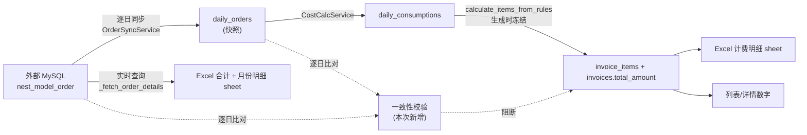

# 结算单明细数据一致性修复 — 技术方案

> 2026-11-05 与用户确认定稿：范围 = 一致性 + 同步层根治；快照与外部不一致时**拒绝生成并提示重新同步**；历史脏数据本次不动。

---

## 一、根因（已用生产库 + 外部 MySQL 实证）

### 1.1 计数不一致：合计 233 vs 计费明细 228

两个数字来自**两个独立数据源、两个不同时间点**：

| 数字 | 来源链路 | 取数时刻 |
|---|---|---|
| 模型总数量 / 计费模型数量 = **233** | Excel「合计」sheet ← `InvoiceExcelService._build_and_save_excel` 的 `model_count = len(order_details)` ← `_fetch_order_details()` **实时查外部 MySQL** `nest_model_order` | 明细生成时（2026-11-02） |
| 单层 207 + 多层 21 = **228** | Excel「计费明细」sheet ← 冻结的 `InvoiceItem` ← `BillingService.calculate_items_from_rules()` ← `daily_consumptions` ← `daily_orders` | 订单同步时（2026-10-31 15:21 CST） |

**钱是按 10-31 下午的快照算的，模型数是 11-02 现查的。** 差额 5 = `+10 漏算 − 4 过期 − 1 重复`：

- **+10 笔漏算**：10-31 当天 15:20 手动跑同步（SyncTask `01d5f598`，`sync_task_logs` id 181）时，外部库该客户（`group_type=1543`）当天只有 7 笔可结算订单；随后 10 笔在 UTC 07:43–09:59（CST 15:43–17:59）才上传完成，**此后再没有人重跑过 10-31** → `daily_orders` / `daily_consumptions` 冻结在 228。
- **−4 笔过期**：`OPPD_umq41792286528`、`maoZ1792658327`、`OPPD_SzPT1792661234`、`wsRd1793421087` 的 `upload_date` 事后被改到 2026-11-01，但 `OrderSyncService._clear_orders()` 只清「当天」的旧行，不回溯清理 10-24/10-30 的残留 → 10 月快照里仍留着它们。
- **−1 笔重复**：`OPPD_SzPT1792661234` 在 `daily_orders` 里同时存在 10-24 和 10-30 两行。实测 `count(*)=228`、`count(distinct order_code)=227`，唯一约束是 `(order_code, sync_date)`，同一订单跨日会被计两次。

### 1.2 为什么没人发现：三道防线全失效

1. `sync_schedule_configs` 中 `daily_sync` **`enabled = f`** —— 每日自动同步是关的，10 月全靠手动补同步。
2. `skip_existing` 模式下 `SyncTaskService._check_data_completeness()` 只要「当天已有订单 + 已有费用」就整体跳过 → **无论重跑多少次都修不回 10-31**。
3. 结算单生成、明细生成全链路**没有任何地方比对「冻结快照量」与「外部实时量」**，233 vs 228 被静默交付。

### 1.3 金额不一致：`InvoiceItem` 不存 subtotal

`InvoiceItem` 只有 `quantity` / `unit_price`，模型注释写着 `# subtotal = quantity * unit_price` —— 这对**多层递增（incremental）**模式是错的：

```
真实小计 = order_count × unit_price + (total_floor_count − order_count) × additional_floor_price
落库值   quantity = total_floor_count, unit_price = unit_price
```

`invoice_excel.py` 的「计费明细」sheet 又用 `subtotal = quantity * unit_p` 重算一遍，于是明细小计合计 ≠ `invoices.total_amount`。

**实证**：`sum(invoice_items.quantity × unit_price)` 与 `invoices.total_amount` 不符的共 2 张，全是常州我爱我家（customer 27544）：

| invoice | total_amount | items_sum | diff |
|---|---|---|---|
| 1448 `INV-20261102-27544-WN0B` | 6748.00 | 6874.00 | −126.00 |
| 1650 `INV-20261102-27544-OETC` | 6748.00 | 6874.00 | −126.00 |

其规则为 `fixed / L / multi / unit_price=14 / incremental / additional_floor_price=11`：78 单 120 层，`3 × (120−78) = 126`。

### 1.4 已排除的假设

**不存在 8 小时时区偏移。** 实证：272 笔 `upload_date` UTC 16:00 之后的订单，`daily_orders.sync_date` 全部 = 自然日 +1 天；`local_date_to_utc_start()` 产生的 aware UTC datetime 经 pymysql 以 UTC 墙钟渲染，日/月边界与 CST 严格对齐。`invoices.period_start` 实测存的是 `2026-09-30 16:00:00Z`（= CST 10-01 00:00），`period_end` = `2026-10-31 15:59:59Z`，与逐日同步窗口完全重合（两种窗口实测都返回 233 行）。同步与 Excel 用的是同一套正确窗口。

### 1.5 其它确认无问题项

- `DETAIL_SQL` 未按客户过滤，只按 `group_type`。实测 `group_type=1543` 下 `count(distinct owner_company)=1`，当前数据 1:1 无泄漏；属潜在脆弱点，不在本次改。
- `POST /invoices/<id>/regenerate-detail` 全仓仅一处定义（`invoices.py:2644`），带 `@require_permission("billing:detail_regenerate")`，无重复注册。

---

## 二、数据链路



断点在 G 与 D 之间没有对齐，也在 D 与 F 之间（详情抽屉实时重算）。

---

## 三、设计原则

1. **钱和量只能有一个口径**：`invoices.total_amount` 与 `invoice_items` 是唯一权威（冻结快照）。任何展示层都从它派生，不允许二次实时计算。
2. **不一致必须在交付前被拦住**，而不是写进文件后靠人发现。
3. **修复动作必须可执行**：报错信息要能直接告诉运营「重同步哪几天」，而不是「请检查数据」。

---

## 四、改动清单

### F1 生成前一致性校验（新增，核心）

**新文件** `backend/app/services/invoice_consistency.py`：

```python
class InvoiceConsistencyError(ValueError):
    """快照与外部实时数据不一致"""
    def __init__(self, customer_name: str, diffs: list[DayDiff]): ...

@dataclass(frozen=True)
class DayDiff:
    day: str        # CST 日期 'YYYY-MM-DD'
    external: int   # 外部可结算订单数
    local: int      # daily_orders 行数
```

`async def diff_period(customer_id, company_id, period_start, period_end, external_engine) -> list[DayDiff]`

- 外部侧（一条 SQL，按 CST 日分组）：
  ```sql
  SELECT DATE(D.upload_date + INTERVAL 8 HOUR) AS d, COUNT(*) AS c
  FROM nest_model_order D
  WHERE D.group_type = :group_type
    AND D.upload_date >= :start_dt AND D.upload_date < :end_dt
    AND ((D.order_status >= 3 AND D.order_status <= 12) OR D.order_status = 15)
  GROUP BY DATE(D.upload_date + INTERVAL 8 HOUR)
  ```
  `+ INTERVAL 8 HOUR` 把 naive UTC 墙钟折算成 CST 日历日，与 `local_date_to_utc_start()` 语义一致（`start_dt = period_start`，`end_dt = period_end + 1s`，与 `_fetch_order_details` 完全同窗）。
- 本地侧：`select(DailyOrder.sync_date).where(customer_id, sync_date >= period_start, sync_date < period_end + 1s)`，在 Python 里用 `utc_to_cst_date_str()` 分桶计数（避免 PG 会话时区差异）。
- 返回差异日列表（含外部有本地无、本地有外部无两种方向）。

**外部库不可达时返回 `None`**（与 `_fetch_order_details` 的容错语义一致），调用方记 warning 后放行，不因基础设施故障阻塞业务。

**接入点**：

| 位置 | 行为 |
|---|---|
| `BillingService.generate_invoice()` | 开头校验，不一致抛 `InvoiceConsistencyError` |
| `BillingService.generate_invoices_batch()` | 循环内校验，不一致 `skipped.append({... "reason": "数据不一致：..."})` 并 `continue` |
| `routes/billing/invoices.py` 的 `generate` / `generate-batch` | 捕获 `InvoiceConsistencyError` → `40001` + 可执行文案 |

错误文案示例：

```
客户「住在好房」(company_id=1543) 2026-10 账期数据不一致，已拒绝生成结算单：
  2026-10-31 外部可结算订单 17 笔，本地已同步 7 笔（缺 10 笔）
请对上述日期执行「强制覆盖」模式同步后重新生成。
```

批量场景把每个客户的差异汇总成 `skipped[].reason`，不阻断其它客户。

### F2 明细 Excel 三表同源

**`backend/app/services/invoice_excel.py`**

1. `_fetch_order_details()` 增加 `order_codes: set[str] | None = None`；非 None 时在 Python 侧按 `row['order_code'] in order_codes` 过滤（不改 SQL，避免大 IN 列表）。
2. `tasks/invoice_detail_generator.py` 查询该客户该周期的 `daily_orders.order_code` 集合传入。集合为空（周期内无同步订单）时传空集合 → 「月份明细」为空表，与「合计 0 套」自洽。
3. `_build_and_save_excel()`：
   - `model_count = sum(Decimal(str(item.get("order_count") or 0)) for item in invoice_items)`，「模型总数量」与「计费模型数量」都取该值。
   - 当 `len(order_details) != model_count` 时，把差异写进「合计」sheet 第 10 列「备注」：`外部实时订单 233 笔，本单计费 228 笔，差异 5 笔（请核对同步完整性）`。这是兜底，正常链路下已被 F1 拦住。
   - 「计费明细」sheet 的「小计（元）」列由 `quantity * unit_p` 改为 `item["subtotal"]`（见 F3）。
4. `unit_price` 参数保留（签名兼容），但不再参与数量口径。

### F3 `invoice_items` 增加 `subtotal` / `order_count`

- `backend/app/models/billing.py` `InvoiceItem` 新增：
  ```python
  subtotal: Mapped[Decimal | None] = mapped_column(DECIMAL(12, 2), nullable=True,
      comment="真实小计（多层递增/阶梯/包年下 ≠ quantity×unit_price）")
  order_count: Mapped[int | None] = mapped_column(Integer, nullable=True,
      comment="计费订单数（多层递增时 quantity 为层数，需此列还原单数）")
  ```
- Alembic 迁移（接当前 head，命名沿用既有 `<随机串>_add_invoice_item_subtotal_order_count.py`）：两列均可空、**不回填**。历史行 `subtotal IS NULL`，展示层 `COALESCE(subtotal, quantity*unit_price)`，历史文件行为不变。
- `BillingService.calculate_items_from_rules()` 在每个 `items.append({...})` 里补 `"subtotal": subtotal`（四个分支：package limited、fixed incremental、fixed unified、tiered）。
- `BillingService.generate_invoice()` 落库时写入两列。
- `_calculate_tiered_price` / package 分支原本就持有 `subtotal` 局部变量，直接带上即可。

### F4 详情抽屉读冻结快照

**`routes/billing/invoices.py` `get_invoice()`**

- 删除 `calculate_items_from_rules(...)` 实时重算块（约 275–282 行）。
- 改为 `selectinload(Invoice.items).selectinload(InvoiceItem.pricing_rule)`，用 `item` + `item.pricing_rule` 组装响应，字段与现结构保持一致：
  - `quantity` ← `item.quantity`
  - `subtotal` ← `COALESCE(item.subtotal, item.quantity * item.unit_price)`
  - `order_count` ← `item.order_count ?? item.quantity`（前端 `invoiceFormatters.ts` / `InvoiceDetailDrawer.vue` 已有 `order_count ?? quantity` 兜底，既有测试覆盖）
  - `unit_price` / `additional_floor_price` / `multi_floor_pricing_type` ← item + rule
  - `pricing_type` ← `rule.pricing_type`（注意 DB 枚举值为 `fixed`/`tier`/`package`，代码里判的是 `"tiered"`，本次**只透传不改语义**，另开 issue 跟踪）
  - `tiers` / `package_type` / `package_limits` ← `rule.*`
- `TierFormatError` 分支随之删除（不再调用归一化入口）。

### F5 结算单周期去重

`BillingService` 新增 `_check_invoice_period_overlap(customer_id, period_start, period_end) -> Invoice | None`：

```sql
SELECT id, invoice_no FROM invoices
WHERE customer_id = :cid AND deleted_at IS NULL
  AND status != 'cancelled'
  AND period_start <= :end AND period_end >= :start
```

- `generate_invoice()` 开头调用，命中抛 `ValueError`，路由转 `40001`，文案带已有单号。
- `generate_invoices_batch()` 循环内调用，命中进 `skipped`，reason = `已存在同期结算单 INV-xxx`。
- 用既有索引 `idx_invoice_customer_period (customer_id, period_start, period_end)`。

### F6 同步层根治

**`services/sync_task_service.py` `execute_task()`**

`skip_existing` 分支前加当天判断：

```python
if task.sync_mode == "skip_existing" and sync_date != cst_today():
    has_orders, has_consumptions = await self._check_data_completeness(sync_date_dt)
    ...
```

当天的数据在持续上传，任何快照都是残缺的，重复执行必须重拉。

**`services/order_sync.py` `_match_and_save()`**

保存前做跨日清理：

1. 收集本批 `order_codes`。
2. 查 `daily_orders` 中 `order_code IN (...)` 且 `sync_date` 不在当天的行 → 按 `(customer_id, sync_date)` 聚合出受影响旧日。
3. 删除这些残留行。
4. 对每个受影响 `(customer_id, old_day)` 调 `CostCalcService(self.db).calculate_daily_cost(old_day)` 重算该日消耗（`_clear_consumptions` + 重建，幂等）。
5. 每条迁移写一条 `SyncDetail(level="warning", category="order_move")`：`订单 {code} 上传日期由 {old} 变更为 {new}，已迁移并重算 {old} 消耗`。

`order_sync` 对 `cost_calc` 的引用放在方法内延迟 import，避免循环依赖。

---

## 五、边界与注意点

1. **package 客户**：`daily_consumptions` 在无订单日也会写一行 `device_type='package'`，但 `daily_orders` 为空 → F1 的本地计数为 0、外部计数也为 0（外部 SQL 按 `group_type` 统计订单），不误报。
2. **`/invoices/generate` 显式传 items 的路径**：items 由调用方给定，可能与 `daily_orders` 不一致 → F1 会报不一致。这是期望行为（该路径本就绕过了快照），需在接口文档注明。
3. **`regenerate-detail` 不跑 F1**：单已存在，重新生成不应被新增校验卡死；F2 的备注列兜底暴露差异。
4. **F2 的订单号集合**取自 `daily_orders`，与 `invoice_items` 同源；若存在跨日重复（修复前的历史数据），`len(order_details) < sum(order_count)`，差额会进备注列——这是有意的可见性，不静默。

---

## 六、为什么只需针对性重同步，不需要全量

- F1 是**按客户 × 账期逐日**比对的，报错直接给出客户名 + 差异日期清单（例：只需 `2026-10-31`）。
- 修复动作 = 对这些日期跑一次 `force_overwrite` 同步。同步任务本身按日期区间全局执行（不按客户过滤），所以是「重同步那几天」。
- 本例只需重同步 **2026-10-31 一天**；F6 落地后，该次重同步会顺带清掉 4 笔跨日残留并重算 10-24/10-30。
- 全量重同步代价：外部库单月可结算订单约 5.9 万笔（各 `group_type` 合计），会重写所有客户全部历史快照，风险远大于收益；且逐日逐客户校验下，没问题的日期不会被误报，没有全量的必要。

---

## 七、历史脏数据修复步骤（本次不执行，用户择机）

1. 删除重复结算单：`UPDATE invoices SET deleted_at = now() WHERE id = 1603`（保留 1385；或反之，需业务确认哪张是正式单）。
2. `force_overwrite` 重同步 `2026-10-24` ~ `2026-10-31`（覆盖 4 笔过期订单的旧日落点 + SzPT 重复日 + 10-31 残天）。
3. 重同步后复核：`select count(*), count(distinct order_code) from daily_orders where customer_id=27542 and sync_date >= '2026-09-30 16:00' and sync_date < '2026-10-31 16:00'` 应为 233/233。
4. 重新生成 1385 的明细文件，核对三表一致。

---

## 八、验证方案

### 自动化

- `backend/tests/unit/test_invoice_consistency.py`：逐日比对的方向判定（外部多/本地多/一致）、外部库不可达返回 None、`+ INTERVAL 8 HOUR` 的 CST 分桶正确性（用 16:00 边界样本）。
- `backend/tests/integration/test_invoice_generation_guard.py`：只同步部分日期 → 单张生成 40001、批量进 skipped；补齐同步后生成成功且三表数字一致。
- `backend/tests/integration/test_invoice_item_subtotal.py`：incremental 模式下 `sum(subtotal) == total_amount`。
- `backend/tests/unit/test_order_sync_cross_day.py`：`upload_date` 跨日变更后旧日行被删、旧日 `daily_consumptions` 已重算。
- `backend/tests/integration/test_invoice_period_dedup.py`：同周期二次生成被拒 / 批量跳过。
- 既有 `InvoiceDetailDrawer.usageTotal.test.ts` 必须继续通过（F4 不改前端契约）。

### 冒烟（对 dev 库）

1. 造场景：对 27542 只跑 `2026-10-01 ~ 2026-10-30` 的 `skip_existing` 同步 → 生成 10 月结算单 → 断言被拒且文案含 `2026-10-31`。
2. `force_overwrite` 补同步 10-31 → 再生成 → 下载 Excel，核对「合计」/「计费明细」/「月份明细」三个数字相等。
3. 对 27544（incremental）重新生成，核对 `sum(subtotal) == total_amount`。
4. 详情抽屉打开同一张单两次，中间插入一次同步，确认数字不变。

### 质量门禁

`pytest` 全量 + `ruff` + `pyright`；前端 `vue-tsc` + `vitest`。

---

## 九、风险与回滚

| 风险 | 缓解 |
|---|---|
| F1 误报导致业务卡住 | 外部库不可达返回 None 放行；误报根因是逐日分桶口径，已用 272 笔 16:00 边界样本验证 |
| F6 跨日清理误删 | 只在 `order_code` 完全匹配且 `sync_date` 不等于当天时删除；删除后立即重算该日消耗，失败即回滚整天 |
| F3 迁移影响历史数据 | 两列可空、不回填、展示层 COALESCE，历史文件零变化 |
| F4 改动详情接口响应 | 字段结构不变；`order_count`/`subtotal` 有兜底；前端既有用例覆盖 |

回滚：F1/F2/F4/F5/F6 均为纯代码改动，revert 即回滚；F3 迁移提供标准 `downgrade()` 删两列。

---

## 十、不在本次范围

- 开启 `daily_sync` 自动同步（属配置变更，需用户确认后单独执行）。
- 历史脏数据修复（第七节）。
- `PricingRule.pricing_type` 的 `tier` / `tiered` 命名不一致（当前无 `tier` 数据，另开 issue）。
- `DETAIL_SQL` 未按 `owner_company` 二次过滤的潜在脆弱点（当前 `group_type` 与公司 1:1）。
